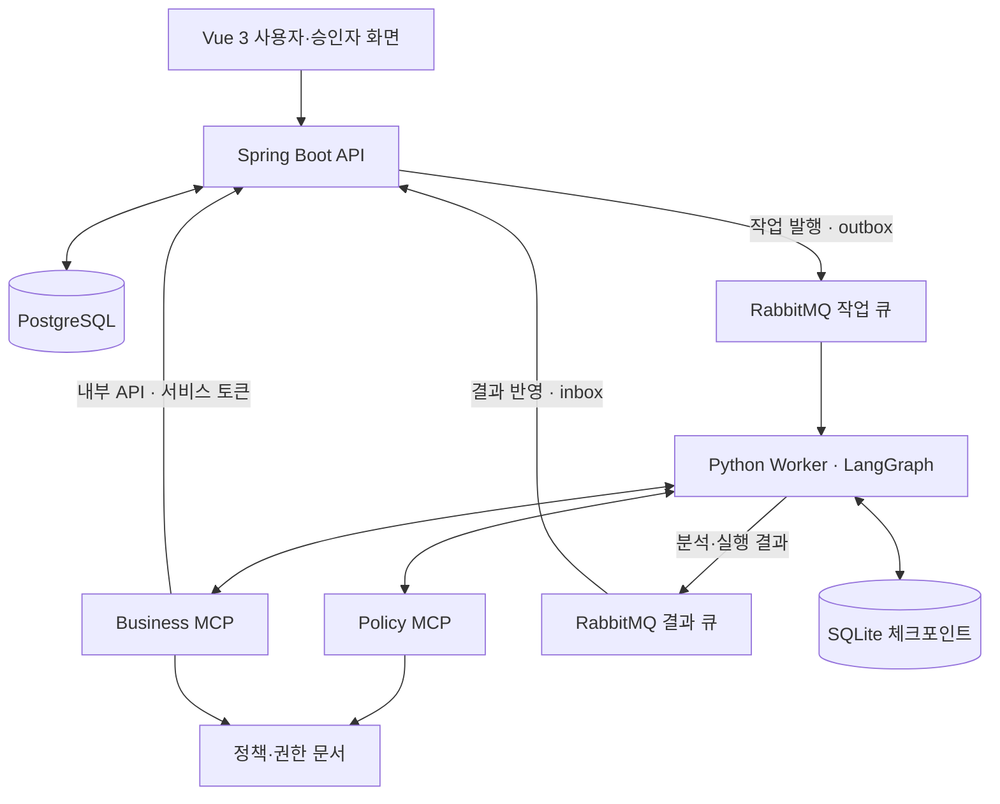
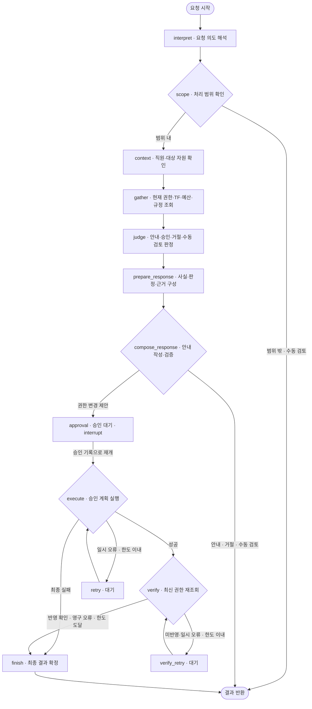

# UnlockOps

> 사내 서비스 접근 문제를 진단하고, 규정 검토와 담당자 승인을 거쳐 권한 변경까지 연결하는 AI 업무 지원 서비스

UnlockOps는 “프로젝트가 보이지 않아요”, “저장소에 코드를 올릴 수 없어요”와 같은 사내 SaaS 접근 문제를 처리합니다.

사용자의 요청과 현재 권한, 직무·직급, TF 소속, 회사 규정을 함께 확인하여 해결 방법을 안내하거나 권한 변경을 제안합니다. 권한 변경은 지정 승인자의 승인을 받은 뒤 실행하며, 변경 후 실제 반영 여부를 다시 조회합니다.

## 1. 프로젝트 배경

사내 서비스 접근 문제를 해결하려면 사용자가 필요한 권한과 승인 담당자를 직접 확인해야 합니다. 관리자는 요청자의 소속과 권한 기준을 확인하고, 변경 결과까지 점검해야 합니다.

UnlockOps는 이 과정을 **접수 → 진단 → 규정 검토 → 승인 → 실행 → 검증**으로 연결하여 반복적인 확인 업무를 줄이고, 판단 근거와 처리 이력을 남기는 것을 목표로 합니다.

## 2. 주요 기능

| 기능 | 설명 |
|---|---|
| 접근 문제 분석 | 요청에서 플랫폼·대상 자원·필요 권한을 파악하고 현재 접근 조건 조회 |
| 규정 기반 권한 검토 | 회사 권한표와 정책 문서를 검색하여 직무·직급·TF·예산 조건 확인 |
| 근거 기반 해결 안내 | 권한 변경이 필요하지 않은 문의에 문서 근거를 활용한 안내 제공 |
| 승인 요청 및 반려 | 지정 승인자가 대상·권한·근거를 확인하여 승인하거나 사유와 함께 반려 |
| 승인된 권한 변경 | 승인 계획과 최신 자격을 재검증한 뒤 모의 SaaS 권한 변경 |
| 변경 결과 검증 | 실행 후 권한을 재조회하여 반영 여부 확인 |
| 요청·승인 현황 조회 | 요청자 본인 이력, 승인자 담당 요청, 운영 담당자 전체 이력 조회 |

지원 플랫폼은 GitHub, Jira, Slack, Notion입니다. 현재 권한 변경 대상은 **모의 SaaS 환경**이며, 실제 외부 SaaS API와는 연결하지 않습니다. Notion 편집 권한은 자동 부여하지 않고 수동 검토로 전환합니다.

## 3. 시스템 아키텍처



| 구성 요소 | 책임 |
|---|---|
| Vue 3 | 요청 접수, 본인 이력, 승인 카드와 담당 현황 표시 |
| Spring Boot | 인증, 요청·승인 상태, 업무 데이터, 권한 변경 트랜잭션 관리 |
| LangGraph Worker | 요청 분석, 규정 검토, 승인 대기·재개, 실행·검증 진행 |
| Policy MCP / Business MCP | 문서 검색과 업무 조회·변경 기능을 에이전트 도구로 제공 |
| RabbitMQ | API와 에이전트 사이의 작업·결과 비동기 전달 |
| PostgreSQL / SQLite | 업무 데이터·처리 이력 / 에이전트 체크포인트 저장 |

Business MCP는 Spring 내부 API를 호출하며 업무 DB에 직접 접근하지 않습니다. Spring은 실행 직전에도 승인된 계획과 최신 자격을 검증합니다.

## 4. Agent 워크플로우

현재는 **하나의 LangGraph 안에서 역할별 노드가 협력하는 구조**입니다. 아래 그래프는 `agent/unlockops/graph.py`의 현재 주 처리 경로를 기준으로 작성했습니다.



- **해석·조회**: 요청의 사용법 문의·오류 해결·권한 신청을 구분하고, 실제 직원·권한 정보와 문서 근거를 수집합니다.
- **판정·답변**: LLM 모드에서는 권한 검토안과 안내를 생성하며, 코드가 규정 상한·승인 조건·인용 근거를 검증합니다.
- **승인 대기**: 체크포인트를 저장하고 실행을 중단합니다. 지정 승인자의 승인 후 같은 요청을 이어서 처리합니다. 반려는 Spring에서 사유와 함께 기록하며 권한 실행으로 진행하지 않습니다.
- **실행·검증**: 서버가 승인·자격을 재검증한 뒤 변경하고, 최신 권한을 다시 조회합니다. 실행과 검증은 각각 총 3회 이내에서 제한적으로 시도합니다.

일반 안내 성공은 `DONE / result_type=GUIDANCE`, 권한 반영 확인은 `DONE / result_type=ACCESS_VERIFIED`로 구분합니다. 안내는 실제 권한 변경이나 오류 해결을 의미하지 않으며, 근거 부족·모델 장애는 `MANUAL_REVIEW`로 남습니다.

## 5. RAG와 MCP

### RAG

정책 문서와 회사 접근 권한표를 청크로 나누어 검색하고, 관련 근거를 권한 검토와 답변 생성에 활용합니다.

| 항목 | 구현 내용 |
|---|---|
| 기본 검색 | 문자 n-gram TF-IDF·코사인 유사도 |
| 선택 기능 | 외부 임베딩 API 기반 검색 |
| 정책 자료 | `data/policy_corpus.md` |
| 회사 권한 자료 | `data/company-a-access-matrix.md` |
| 근거 관리 | 문서 ID, 조항, 버전, 원문 SHA-256 보존 |
| 답변 검증 | 인용 ID와 원문 발췌 일치 여부 검사 |

직원 정보·현재 권한·예산은 업무 API에서 조회합니다. 권한 상한은 회사 권한표 원문과 대조하며, 필수 근거가 부족하거나 변경된 경우 자동 부여를 차단합니다.

### MCP

| 서버 | 제공 기능 |
|---|---|
| Policy MCP | 정책 문서 검색, 원문 조항 조회 |
| Business MCP | 직원·자원·권한·TF·예산·회사 규정 조회, 승인된 권한 변경 및 검증 |

조회 도구와 변경 도구를 구분하며, 변경 도구는 서버에 저장된 승인 계획을 기준으로 실행합니다. 실행 도구의 입력은 `problem_id`, `idempotency_key`로 제한하여 모델이 사용자·자원·역할을 임의로 지정하지 못하도록 합니다.

## 6. 하네스와 실행 통제

에이전트의 판단을 실제 업무에 연결하기 위해 다음 통제를 적용했습니다.

| 통제 항목 | 적용 내용 |
|---|---|
| 도구 사용 제한 | 요청자의 직원·플랫폼·자원 범위와 호출 횟수·시간 제한 |
| 입출력 검증 | 도구 입력·응답 스키마와 필수 값 검사 |
| 승인 게이트 | LangGraph interrupt와 체크포인트를 통한 승인 대기·재개 |
| 승인 계획 검증 | 계획 해시 비교, 실행 직전 승인·규정·자격 재검증 |
| 중복 처리 방지 | 실행 키와 영수증, outbox/inbox를 통한 중복 반영 제어 |
| 장애 대응 | 일시 오류의 제한 재시도와 처리 이벤트 기록 |
| 결과 확인 | 실행 후 최신 권한 재조회 |

권한 변경·예산 차감·실행 영수증은 하나의 DB 트랜잭션으로 처리합니다. 메시지는 중복 전달될 수 있으며, 실행 키·영수증·DB 잠금으로 권한과 예산의 중복 반영을 제어합니다.

인증에는 세션·BCrypt·CSRF 보호를 적용하고, 지정 승인자 확인과 본인 승인 차단을 수행합니다. `MCP_TOKEN`은 Agent → MCP, `INTERNAL_API_TOKEN`은 Business MCP → Spring 인증에 사용합니다. 제공된 환경 설정은 로컬 데모용입니다.

## 7. 기술 스택

| 영역 | 기술 |
|---|---|
| Frontend | Vue 3, TypeScript, Vite |
| Backend | Java 21, Spring Boot 3.5.7, Spring Security, JDBC, Flyway |
| Agent | Python 3.11+, LangGraph, LangChain OpenAI |
| 도구 연동 | MCP Python SDK |
| 문서 검색 | TF-IDF·코사인 유사도, 선택적 외부 임베딩 |
| 메시지·저장소 | RabbitMQ, PostgreSQL, SQLite |
| 실행 환경 | Docker Compose, uv, Maven |

## 8. 실행 방법

### 전체 서비스 실행

Docker Desktop 실행 후 프로젝트 루트에서 아래 명령을 실행합니다.

```sh
cp .env.example .env
docker compose up --build
```

- 서비스 화면: <http://localhost:8088>
- RabbitMQ 관리 화면: <http://localhost:15672>

중단은 `docker compose stop`입니다. DB와 체크포인트 볼륨은 유지됩니다.

### 실행 모드

| 모드 | 동작 |
|---|---|
| `AGENT_MODE=demo` | 외부 LLM 호출 없이 규칙 기반으로 처리 경로 재현 |
| `AGENT_MODE=llm` | LLM 기반 요청 해석·조회 도구 선택·권한 제안·답변 생성 |

LLM 모드는 `.env`에서 다음 항목을 설정하고 서비스를 다시 실행합니다.

```dotenv
AGENT_MODE=llm
LLM_API_KEY=<API 키>
LLM_BASE_URL=<모델 API 주소>
LLM_MODEL=<사용할 모델>
```

기본 demo 모드는 외부 LLM을 호출하지 않습니다. 임베딩 설정을 비워 두면 로컬 TF-IDF 검색을 사용합니다. 실제 모델의 도구 선택을 시연할 때는 LLM 모드가 필요합니다.

### 데모 계정

비밀번호는 `.env`의 `DEMO_PASSWORD`를 사용합니다.

| 계정 | 역할 |
|---|---|
| `kim_dev` | 접근 권한 신청자 |
| `park_lead` | 결제 TF 승인자 |
| `yoon_head` | 개발팀 부서장 |
| `song_ops` | 전체 처리 이력 조회 담당자 |

운영 담당자는 지정 승인자를 대신하여 승인할 수 없습니다.

### 로컬 개발·검증

Python 3.11+, uv, Node.js 22.12+, Java 21, Maven을 사용합니다.

```sh
uv --cache-dir .cache/uv sync --extra test
.venv/bin/python -m pytest -q
```

프론트엔드는 `frontend/`에서 `npm ci`, `npm test`, `npm run build`를 실행합니다. 백엔드는 `backend/`에서 `mvn test`를 실행합니다. Windows에서는 `.venv/bin/python` 대신 `.venv/Scripts/python.exe`를 사용합니다.

MCP·Worker 개별 실행과 VS Code 디버깅은 [디버깅 안내](../docs/debugging.md)를 참고하세요. 테스트 실행 범위와 실제 전체 스택 검증 여부는 [검증 기록](../docs/verification.md)에 구분하여 정리했습니다.

## 9. 시연 시나리오

### 메인 시나리오: 결제 개편 TF 발령 후 서비스 접근 지원

> “어제 결제 개편 TF로 발령났는데 payment-core에 Push가 안 되고, Jira 프로젝트도 안 보이고, 채널도 없고, 팀 위키 Notion 페이지도 안 열려요.”

신규 TF 구성원이 여러 서비스에 접근하지 못하는 상황을 메인 시나리오로 설정했습니다. **현재 구현은 한 요청에서 하나의 플랫폼·자원을 처리하므로, S1은 아래 S1-a~d의 독립 요청으로 나누어 시연합니다.** 통합 문장 한 건에서 네 플랫폼의 승인·실행을 자동으로 묶지는 않습니다.

아래 정상 경로는 `kim_dev`(E-001)가 해당 권한을 아직 보유하지 않은 초기 데모 데이터를 기준으로 합니다.

| 시나리오 | 플랫폼 | 입력 예시 | 예상 권한·처리 |
|---|---|---|---|
| **S1-a · 저장소 Push** | GITHUB | “payment-core에 git push 하면 권한이 없다고 나와요” | `Write` 제안 → TF 리더 승인 → 부여·재조회 |
| **S1-b · 프로젝트 조회** | JIRA | “Jira 로그인은 되는데 PAY 프로젝트가 목록에 안 떠요” | `Developer` 제안 → TF 리더 승인 → 부여·재조회 |
| **S1-c · 채널 접근** | SLACK | “#proj-payment 채널이 검색이 안 돼요” | `Member` 제안 → TF 리더 승인 → 부여·재조회 |
| **S1-d · 위키 열람** | NOTION | “결제 개편 TF 위키 페이지를 열면 접근 권한이 없다고 떠요” | `Can view` 제안 → TF 리더 승인 → 부여·재조회 |

1. `kim_dev`로 로그인하여 플랫폼을 선택하고 S1-a~d 중 한 요청을 접수합니다.
2. 에이전트가 TF 소속, 현재 권한, 직무·직급과 규정 근거를 확인합니다.
3. `WAITING_APPROVAL` 상태와 지정 승인자의 승인 카드를 확인합니다. 이 시점에는 권한이 변경되지 않습니다.
4. `park_lead`로 로그인하여 대상·권한·근거를 확인하고 승인합니다.
5. 승인 계획과 최신 조건을 재검증한 뒤 권한을 변경합니다.
6. 최신 권한 재조회가 성공하면 `DONE`으로 전환되며, 신청자가 최종 결과를 확인합니다.

각 요청은 독립된 승인 카드와 처리 이력을 가집니다. 이미 필요한 권한을 보유했다면 중복 부여 대신 안내 경로로 처리합니다.

### 주요 예외 시나리오

| 시나리오 | 입력·시연 조건 | 예상 결과 |
|---|---|---|
| **S2 · TF 비구성원** | `lee_ops`(E-003): “payment-core에 코드를 올려야 해서 Write 권한 부탁드려요” | TF 소속을 확인하여 권한 신청 거절 |
| **S4 · 예산 부족** | `jung_data`(E-005): “Copilot 좌석을 신청하고 싶어요” | 부서 예산 부족으로 좌석 신청 거절 |
| **S5 · 부여 실패** | 모의 Jira 실패 옵션을 켜고 S1-b 접수·승인 | 최초 실행 포함 총 3회 시도 후 실패 처리 |

S5는 PAY 권한을 아직 부여받지 않은 초기 데이터에서 시연합니다. 상세 재현 절차는 [검증 안내](../docs/verification.md)를 참고하세요.

## 10. 현재 구현 범위

- 한 요청에서 하나의 플랫폼·자원을 처리합니다.
- 대상이나 필수 정보가 불명확하면 수동 검토로 전환합니다.
- 실제 SaaS 연동, 복수 플랫폼 통합 승인, 추가 질문을 통한 대화 재개는 구현 범위에 포함하지 않습니다.
- 체크포인트는 단일 Worker 운영을 기준으로 합니다.
- 외부 Slack·이메일 알림 대신 웹 화면에서 처리 이력을 확인합니다.

## 11. 향후 확장 방향

현재의 단일 자원·모의 SaaS 처리 구조를 바탕으로 다음 기능을 확장할 계획입니다.

| 확장 항목 | 주요 내용 |
|---|---|
| 실제 SaaS 연동 | GitHub·Jira·Slack·Notion API를 연결하여 실제 계정과 권한 조회·변경 지원 |
| 복수 플랫폼 요청 처리 | 하나의 요청을 플랫폼별 작업으로 분리하고 승인·실행 결과와 부분 성공을 통합 관리 |
| 추가 질문과 대화 재개 | 대상 자원이나 필요한 정보가 부족하면 사용자에게 질문하고 기존 상태에서 분석 재개 |
| 권한 수명주기 관리 | TF 종료·소속 변경·사용 기한 만료에 따른 권한 재검토와 회수 지원 |
| 외부 알림 연동 | 승인 요청, 반려 사유, 처리 결과를 Slack·이메일로 전달 |
| Worker 확장 | 공유 체크포인트 저장소와 동시 처리 제어를 도입하여 여러 Worker에서 요청 처리 |

## 12. 프로젝트 구조

| 폴더 | 구현 내용 |
|---|---|
| [agent](../agent/README.md) | LangGraph, 요청 해석, 권한 판정, 답변 생성, 도구 호출 통제 |
| [rag](../rag/README.md) | 문서 청킹, 검색, 원문 조항 조회 |
| [mcp](../mcp/README.md) | Policy·Business MCP, 도구 계약, 내부 API 어댑터 |
| [worker](../worker/README.md) | RabbitMQ 작업 소비·결과 발행, 체크포인트 재개 |
| [backend](../backend/README.md) | 인증, 요청·승인, 업무 데이터, outbox/inbox, 권한 실행·검증 |
| [frontend](../frontend/README.md) | 요청 접수, 본인 이력, 승인 카드, 담당 현황 |
| [data](../data/README.md) | 정책 문서와 회사 접근 권한표 |
| [infra](../infra/README.md) | Python Dockerfile, 로컬 디버깅용 Compose 설정 |
| [tests](../tests/README.md) | 실행 중인 전체 스택 대상 선택적 통합 테스트 |
| [docs](../docs/README.md) | 아키텍처, API·메시지 계약, 실행·검증 안내 |

Python 의존성은 루트 `pyproject.toml`과 `uv.lock`으로 함께 관리합니다.

## 13. 상세 문서

- [아키텍처와 Agent 구현](../docs/architecture.md)
- [API 명세](../docs/api-spec.md)
- [MCP·메시지 계약](../docs/contracts/README.md)
- [검증 기록 및 재현 절차](../docs/verification.md)
- [평가 항목별 구현 위치](../docs/rubric.md)
- [정책 해석과 구현 범위](../docs/policy-decisions.md)
- [로컬 개발·디버깅](../docs/debugging.md)
- [기여 안내](../CONTRIBUTING.md) · [Git 컨벤션](../docs/git-convention.md)

GitHub の協업 설정 안내는 [GitHub 협업 설정](GITHUB_SETUP.md)을 참고하세요.
