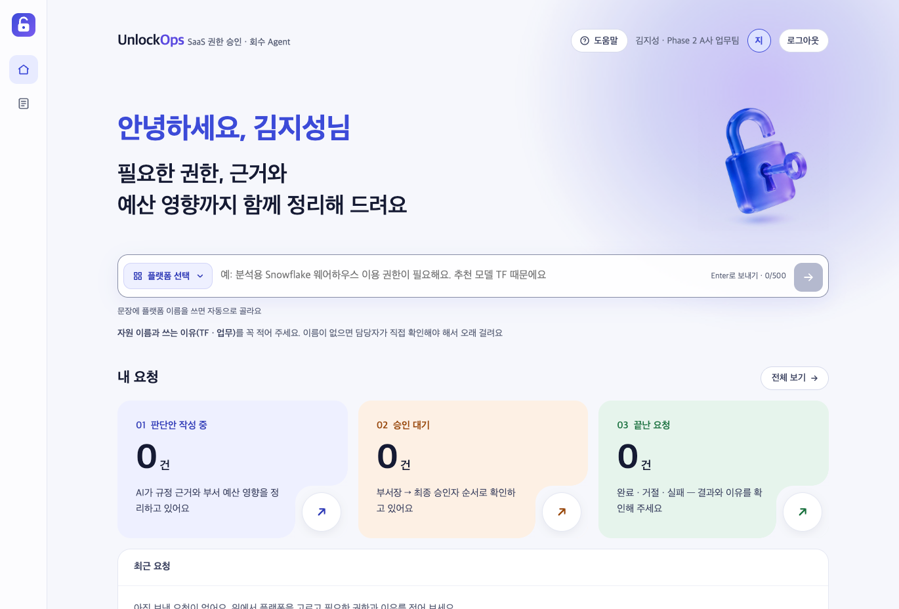
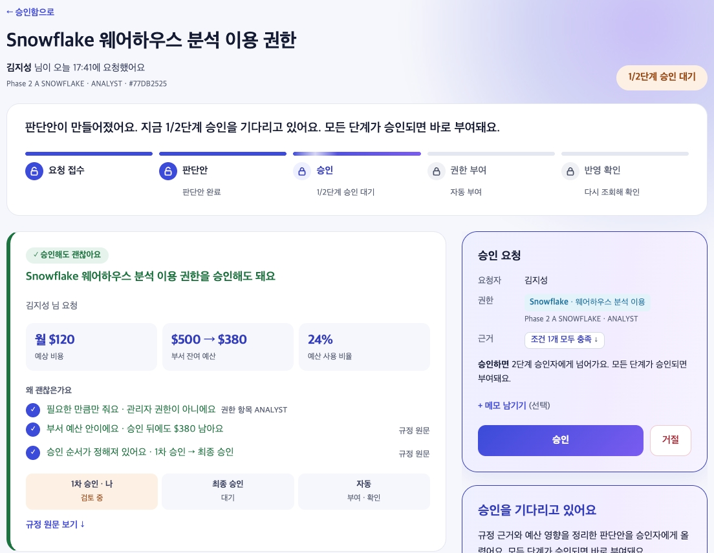
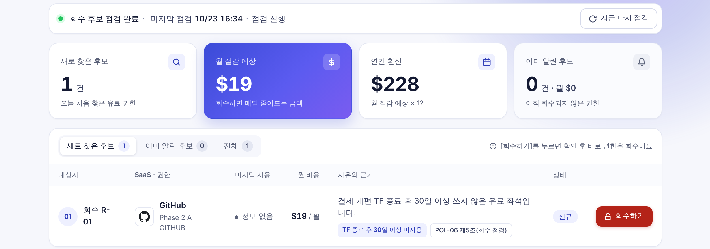
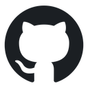
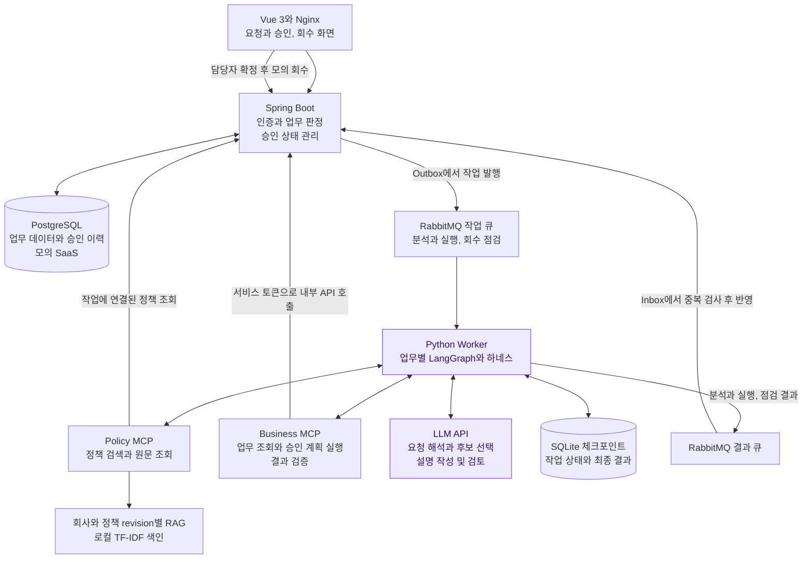
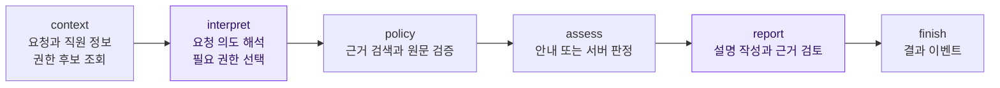
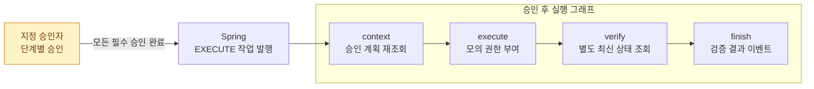
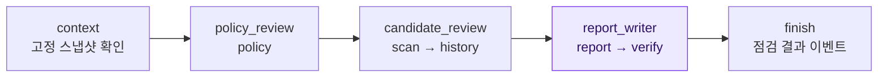
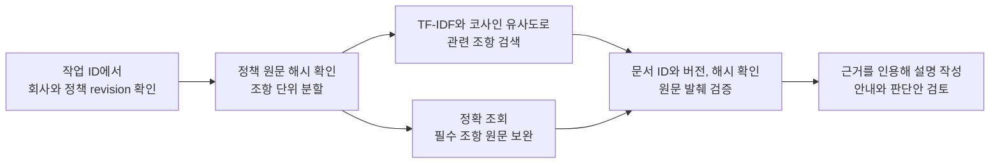
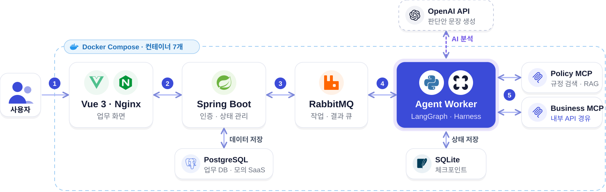

<h3><br>UnlockOps</h3>

<p>
  <strong>SaaS 권한 승인과 회수를 돕는 AI 에이전트</strong><br>
  권한을 줄 때는 근거와 비용을 보여주고,<br>
  안 쓰는 유료 좌석은 회수까지 연결합니다.
</p>

<p>SKALA 4기 5반 2조 <strong>Bana100</strong></p>

<p>
  <a href="#agent-workflows"></a>
  <a href="#rag-design"></a>
  <a href="#mcp-design"></a>
  <a href="#agent-workflows"></a>
</p>

<br clear="right">

<p align="center">
  <a href="#architecture">시스템 아키텍처</a>&emsp;
  <a href="#agent-workflows">Agent 워크플로우</a>&emsp;
  <a href="#rag-design">RAG</a>&emsp;
  <a href="#mcp-design">MCP</a>&emsp;
  <a href="#agent-harness">하네스</a>&emsp;
  <a href="#tech-stack">기술 스택</a>&emsp;
  <a href="#team">팀 소개</a>
</p>

## 어떤 문제를 해결하나요?

IT 권한 담당자는 신청이 들어올 때마다 회사 규정, 부서 예산, 현재 권한을 따로 확인합니다. 업무가 끝난 뒤 남은 유료 좌석도 직접 찾아야 합니다. UnlockOps는 **승인 전 판단과 부여 후 관리**를 하나의 흐름으로 연결합니다.

| 사용자         | 겪는 문제                                             | UnlockOps가 제공하는 것                                         |
| -------------- | ----------------------------------------------------- | --------------------------------------------------------------- |
| 직원           | 어떤 권한을 신청해야 하는지 모르고 처리 상황을 재문의 | 문장으로 신청하고 처리 과정과 결과 확인                         |
| 부서장         | 요청의 필요성과 예산 영향을 일일이 대조               | 필요한 권한과 규정 근거, 예산 변화를 담은 판단안                |
| IT 권한 담당자 | 승인 검토와 미사용 좌석 정리가 수작업에 집중          | 승인한 권한의 반영 여부를 확인하고 회수 후보와 예상 절감액 제공 |

## 핵심 기능과 실제 화면

### 1. 근거와 비용을 확인하고 권한 승인

> “추천 모델 분석용 Snowflake 웨어하우스 USAGE 권한이 필요해요.”

**요청 → 규정과 예산 검토 → 단계별 사람 승인 → 권한 부여 → 반영 확인**

|                                                     문장으로 요청                                                     |                                                                      판단안을 보고 승인                                                                      |
| :-------------------------------------------------------------------------------------------------------------------: | :----------------------------------------------------------------------------------------------------------------------------------------------------------: |
|  |  |
|                                     플랫폼과 업무 목적을 입력하고 진행 상황 확인                                      |                                                          필요한 권한부터 비용과 승인 순서까지 확인                                                           |

A사는 **부서장 → IT 담당자**, B사는 **팀장 → 부서장 → SaaS 담당자** 순서로 승인합니다. B사는 예상 월 비용이 100 USD 이상이면 IT 총괄 승인을 추가합니다. 사용법 문의는 문서를 근거로 안내합니다. 예산이 부족하면 보류하고, 정보나 근거가 불확실하면 수동 검토로 넘깁니다.

### 2. 미사용 유료 좌석을 찾아 담당자 확인 후 회수

**점검 실행 → 회수 후보와 근거 확인 → 담당자 확정 → 모의 회수 후 반영 확인**



- **후보 선별:** TF(프로젝트 전담 조직) 종료 후 30일 이상 미사용한 유료 좌석, 퇴사자 좌석 등을 규정에 따라 점검합니다.
- **오회수 방지:** 다른 활성 TF에서 사용하거나 유지 승인이 있으면 제외합니다. 사용 기록을 조회하지 못한 경우는 미사용으로 간주하지 않습니다.
- **담당자 확정:** 확인 창에서 회수를 결정하면 권한을 종료합니다. 이후 상태를 다시 조회하고 처리 영수증을 저장합니다. 같은 후보의 알림은 중복 생성하지 않습니다.

<br/>

### 시연 대상 10개 플랫폼

<table width="100%">
  <tr>
    <td align="center" width="20%"><br><strong>GitHub</strong></td>
    <td align="center" width="20%"><br><strong>Jira</strong></td>
    <td align="center" width="20%"><br><strong>Slack</strong></td>
    <td align="center" width="20%"><br><strong>Notion</strong></td>
    <td align="center" width="20%"><br><strong>Snowflake</strong></td>
  </tr>
  <tr>
    <td align="center"><br><strong>Databricks</strong></td>
    <td align="center"><br><strong>Salesforce</strong></td>
    <td align="center"><br><strong>Datadog</strong></td>
    <td align="center"><br><strong>Tableau Cloud</strong></td>
    <td align="center"><br><strong>Figma</strong></td>
  </tr>
</table>

<a id="architecture"></a>

## 시스템 아키텍처

**AI는 요청을 해석하고 근거를 설명합니다. Spring은 정책에 따라 판단하고 승인을 관리하며 권한을 변경합니다.** 화면과 Agent 사이의 작업과 결과는 큐로 전달하고, 업무 데이터는 내부 API를 통해 조회하거나 변경합니다.



Compose 서비스는 `frontend`, `backend`, `postgres`, `rabbitmq`, `agent`, `policy-mcp`, `business-mcp`의 7개입니다. 작업 큐와 결과 큐는 같은 RabbitMQ에 있습니다. SQLite는 Worker의 체크포인트 볼륨을 사용합니다. [Compose 구성](compose.yaml), [발표용 구성도](docs/images/readme/architecture.svg)

<a id="agent-workflows"></a>

## AI Agent 설계와 워크플로우

승인 분석, 승인 후 실행, 회수 점검을 각각 별도의 LangGraph로 구성했습니다. **단계별 상태와 조건 분기를 정의하고 체크포인트에 진행 상황을 저장합니다.** 입력과 결과를 검증하다 오류가 발생하거나 이미 지난 작업을 받으면 `finish`에서 정리하고 종료합니다.

| 판단 주체      | 맡는 일                                                                                          |
| -------------- | ------------------------------------------------------------------------------------------------ |
| **LLM**        | 요청을 해석하고 실제 권한 후보를 선택. 근거를 바탕으로 안내와 판단안을 작성하고 회수 사유를 설명 |
| **Agent 코드** | 그래프를 진행하면서 호출 범위를 제한. 후보와 인용, 응답 형식을 검증하고 오류 처리                |
| **Spring**     | 최신 자격과 라이선스, 예산으로 판정. 승인 기록을 관리하고 권한 변경과 최종 상태 확정             |

아래 그래프에서 보라색은 `llm` 모드로 모델을 사용하는 주요 단계입니다. `demo` 모드에서는 외부 LLM 없이 규칙과 템플릿으로 흐름을 재현합니다.

### 1. 승인 요청 분석



`interpret`는 권한을 고를 때 서버가 제공한 **실제 후보의 ID 하나 또는 `null`**을 선택합니다. 권한 신청은 `assess`에서 후보를 다시 확인하고 Business MCP를 통해 Spring의 판정을 받습니다. 이때 직무와 TF 소속, 라이선스 보유 여부, 비용과 예산, 승인자를 확인합니다. 권한만 추가하는 경우와 좌석 구매가 필요한 경우, 사용량 예산을 배정하는 경우도 구분합니다.

다음은 `assess`와 `report` 내부에서 처리하는 분기입니다. 승인 대기로 판정해도 분석 그래프에서는 권한을 변경하지 않습니다.

| 요청과 조건                                  | 결과                                                  |
| -------------------------------------------- | ----------------------------------------------------- |
| 사용법이나 절차 문의                         | 근거를 인용해 안내<br>`DONE` (`result_type=GUIDANCE`) |
| 자격과 예산을 충족하고 근거와 승인 경로 확인 | 판단안과 승인 계획 작성<br>`WAITING_APPROVAL`         |
| 예산 부족                                    | 실행 계획 없이 보류<br>`ON_HOLD`                      |
| 정보나 근거, 대상이 불명확                   | 추측하지 않고 수동 검토<br>`MANUAL_REVIEW`            |
| 이미 보유한 권한                             | 변경 없이 완료<br>`DONE`                              |
| 정책 조건 불충족                             | 신청 반려<br>`REJECTED`                               |

구현: [분석 그래프](agent/unlockops/access/graph.py), [후보 선택](agent/unlockops/access/selection.py), [서버 판정](backend/src/main/java/com/unlockops/access/AccessPlanningService.java), [비용 판정](backend/src/main/java/com/unlockops/access/AccessCosting.java)

### 2. 사람 승인과 승인 후 실행

**분석 그래프는 판단안을 반환하고 종료합니다.** 이후 Spring이 순차 승인과 보류, 반려를 관리합니다. 모든 필수 승인을 확인하면 별도의 `EXECUTE` 작업을 발행합니다. 사람의 승인 대기는 Spring이 관리하며 LangGraph의 `interrupt`를 사용하지 않습니다.



- **실행 전:** Agent와 Spring이 승인 순서와 전체 승인 여부를 확인하고, 계획 해시와 실행 키를 대조합니다. 실행 직전 조건이 달라졌다면 수동 검토로 전환합니다.
- **실행 후:** 저장된 영수증만 믿지 않고 별도 API로 현재 제공자 권한을 재조회합니다. 일치하면 `DONE` (`reason_code=VERIFIED`, `result_type=ACCESS_VERIFIED`), 불일치하면 `FAILED` (`reason_code=VERIFICATION_FAILED`)로 처리합니다.
- **보류나 수동 검토 후 재개:** 최신 조건으로 새 분석 작업과 승인 계획을 만들고 다시 승인받습니다.

구현: [실행 그래프](agent/unlockops/access/execution.py), [승인 상태 관리](backend/src/main/java/com/unlockops/access/AccessWorkflowService.java), [실행과 검증](backend/src/main/java/com/unlockops/access/AccessExecutionService.java)

### 3. 회수 점검과 역할별 서브그래프



`policy_review`, `candidate_review`, `report_writer`는 각각 별도 StateGraph로 구성한 **순차 역할 서브그래프**입니다.

| 역할               | 검증 및 처리 내용                                                                                 |
| ------------------ | ------------------------------------------------------------------------------------------------- |
| 정책 검토          | 이번 점검에 고정된 정책 해시와 **POL-06 제5조** 원문을 확인                                       |
| 후보 검토          | 고정 시점의 모든 페이지를 조회. 건수와 커서를 대조해 중복이나 누락을 검사하고 기존 알림 이력 확인 |
| 보고서 작성과 검토 | 새로 확정된 후보의 설명을 작성하고 판정과 금액, 근거가 바뀌지 않았는지 검증                       |

서버 규칙이 후보를 선별하면 LLM은 확인된 사실을 설명합니다. 인용 원문과 금액은 코드가 붙입니다. 모델 호출이나 검토에 실패하면 정형 설명으로 대체하고, 관측이 부족한 대상은 **추가 확인**으로 남깁니다.

Agent가 `RECLAIM_CHECKED` 결과를 전달하면 Spring이 저장하고 필요한 인앱 알림을 보냅니다. **이 과정까지 끝나야 점검 상태를 `DONE`으로 확정합니다.** 담당자가 확정하는 **모의 회수는 화면 → Spring API** 경로로 실행합니다. 점검 Agent는 권한 변경 도구를 호출할 수 없습니다.

구현: [회수 그래프](agent/unlockops/reclaim/graph.py), [전체 조회](agent/unlockops/reclaim/scan.py), [불변 사실 검증](agent/unlockops/reclaim/verification.py), [설명 작성과 검토](agent/unlockops/reclaim/narration.py), [담당자 회수](backend/src/main/java/com/unlockops/reclaim/ReclaimExecutionService.java)

<a id="rag-design"></a>

## RAG: 회사 정책의 버전에 맞춰 근거 검색



| 항목      | 구현                                                                                                                                                           |
| --------- | -------------------------------------------------------------------------------------------------------------------------------------------------------------- |
| 자료      | 사내 규정과 제품 요약, 진단 힌트, 회사별 승인 흐름을 버전별 정책 묶음으로 관리                                                                                 |
| 검색 방식 | 단어 및 문자 n-gram TF-IDF와 코사인 유사도 사용. 별도 벡터DB나 임베딩 API 없이 동작                                                                            |
| 검색 범위 | 승인 분석은 해당 회사의 정책 revision에서 선택한 플랫폼과 공통 조항을 검색. 회수 점검은 실행에 고정된 정책에서 필수 회수 조항 조회                             |
| 인용 검증 | `doc_id`, `article`, `version`, `source_hash`, 원문 발췌를 보존하고 실제 원문과 대조                                                                           |
| 실패 처리 | 승인 분석의 필수 근거 부족은 수동 검토로 전환. 회수 점검의 필수 근거 검증 실패는 `FAILED / SCAN_FAILED`로 처리. 설명 작성이나 검토 실패는 정형 템플릿으로 대체 |

승인 판정에는 **업무 API의 최신 사실**을 사용합니다. 회수 점검에서는 **스냅샷과 점검 시각에 고정된 사실**을 확인합니다. 문서 예시나 모델의 추론으로 사실을 채우지 않으며, 담당자가 회수를 실행하기 직전에 최신 조건을 다시 확인합니다.

구현: [정책 색인과 검색](rag/unlockops_rag/revisions.py), [승인 근거 선택](rag/unlockops_rag/approval.py), [안내 인용 검증](agent/unlockops/access/answering.py), [보고서 검토](agent/unlockops/common/reporting.py)

<a id="mcp-design"></a>

## MCP: 정책 도구와 업무 도구의 실행 권한 분리

두 MCP 서버에서 **정책 도구 2개와 업무 도구 7개**를 제공합니다. Agent와 서버는 같은 입출력 계약으로 도구를 호출합니다. MCP는 Spring 내부 API를 거쳐 업무 데이터를 조회하거나 변경합니다.

| 서버의 역할                             | 도구                                                                                               |
| --------------------------------------- | -------------------------------------------------------------------------------------------------- |
| **Policy MCP**<br>근거 검색과 원문 조회 | `search_workflow_policy`, `read_workflow_policy`                                                   |
| **Business MCP**<br>승인 분석과 실행    | `get_access_request_context`, `assess_access_request`, `execute_access_plan`, `verify_access_plan` |
| **Business MCP**<br>회수 점검           | `get_reclaim_check_context`, `list_revocation_candidates`, `get_reclaim_notification_history`      |

권한 변경 도구는 `execute_access_plan` 하나이며 **승인 후 실행 단계에서만** 호출할 수 있습니다. 입력을 아래 4개로 제한해 모델이 직원이나 자원, 역할을 임의로 바꿔 실행하지 못하게 합니다.

```text
execute_access_plan(problem_id, job_event_id, plan_hash, idempotency_key)
```

Worker → MCP는 `MCP_TOKEN`, MCP → Spring 내부 API는 `INTERNAL_API_TOKEN`으로 인증합니다. 사용자는 로그인 세션으로 인증하며 화면에서 보내는 요청에는 CSRF 보호를 적용합니다.

구현: [Policy 도구](mcp/unlockops_mcp/policy_tools.py), [Business 도구](mcp/unlockops_mcp/business_tools.py), [공유 입출력 계약](agent/unlockops/common/tool_contracts.py), [내부 API 어댑터](mcp/unlockops_mcp/workflow_backend.py)

<a id="agent-harness"></a>

## 하네스: 모델의 판단부터 실제 실행까지 통제

하네스는 Agent의 실행을 관리하는 코드입니다. **호출할 수 있는 도구와 업무 범위, 실행 시간을 제한하고 결과를 검증합니다.** 장애가 발생했을 때 어디서 다시 시작할지도 관리합니다.

| 단계             | 위험                                                          | 적용한 통제                                                                                                        |
| ---------------- | ------------------------------------------------------------- | ------------------------------------------------------------------------------------------------------------------ |
| 입력과 도구 호출 | 업무 범위를 벗어나거나 호출을 끝없이 반복                     | 단계별 허용 목록과 요청 ID, 작업 ID 검사. 입출력 형식을 검증하고 도구 호출을 최대 **30회**, 호출당 **15초**로 제한 |
| 판단안과 승인    | 모델이 권한이나 비용, 승인자를 지어냄                         | 실제 후보 ID만 선택. 서버가 자격과 비용을 판정하고 지정 승인자의 순차 승인 확인. 본인 승인 차단                    |
| 실행 직전        | 승인 후 정책이나 자격, 예산이 바뀜                            | 계획 버전과 SHA-256, 전체 승인 여부, 실행 키를 대조하고 최신 조건으로 다시 판정                                    |
| 권한과 예산 반영 | 재시도로 권한을 중복 부여하거나 예산을 중복 차감              | 실행 키와 영수증, DB 잠금으로 중복 반영 방지. 권한 변경과 예산 차감, 영수증 저장을 한 트랜잭션으로 처리            |
| 실행 후          | 성공 응답과 실제 권한이 불일치                                | 캐시를 사용하지 않는 독립 재조회. 검증 실패를 완료로 처리하지 않음                                                 |
| 메시지 전달      | 메시지가 유실되거나 중복 전달됨. 지난 작업의 결과가 늦게 도착 | Outbox와 발행 확인, Inbox의 중복 제거 적용. 현재 `job_event_id`와 대조                                             |
| 장애와 재전달    | 같은 도구나 모델 작업을 반복 수행                             | SQLite에 작업 상태와 최종 결과 저장. 재전달된 작업은 저장된 결과 재사용. 재시도 가능한 오류만 제한 재시도          |
| 설명 출력        | 설명을 작성하면서 사실이나 인용, 금액이 바뀜                  | 구조화된 출력을 원문과 서버 사실에 대조. 설명 작성이나 검토 실패 시 정형 템플릿 사용                               |

체크포인트는 **작업 이벤트별로 분리**합니다. Worker는 최종 결과를 저장한 뒤 큐에 전달하고, 메시지가 재전달되면 저장된 결과를 재사용합니다. 이 구조와 서버의 중복 실행 방어를 함께 적용합니다.

구현: [도구 범위와 재시도](agent/unlockops/common/runtime.py), [호출 시간 제한](agent/unlockops/common/tools.py), [실행 한도](agent/unlockops/common/settings.py), [체크포인트와 재전달](worker/unlockops_worker/runtime.py), [결과 중복 제어](backend/src/main/java/com/unlockops/messaging/workflow/WorkflowResults.java), [담당 범위 제어](backend/src/main/java/com/unlockops/common/workflow/WorkflowAccessControl.java)

<a id="tech-stack"></a>

## 기술 스택

<p align="center">
  
</p>

화면과 AI Agent, 모의 SaaS의 구성을 나타낸 발표자료입니다. 작업과 결과 메시지가 오가는 경로, 내부 API 호출 관계는 [시스템 아키텍처](#architecture)에 정리했습니다.

| 영역                     | 기술                                                                                                                                                                                                                                                                                                                                                                                                                                                                       |
| ------------------------ | -------------------------------------------------------------------------------------------------------------------------------------------------------------------------------------------------------------------------------------------------------------------------------------------------------------------------------------------------------------------------------------------------------------------------------------------------------------------------- |
| **Frontend**             |     |
| **Backend**              |    <br>JDBC, Flyway                                                                           |
| **Agent와 도구**         |                                       |
| **RAG**                  | 로컬 TF-IDF와 코사인 유사도 사용. 정책 revision별로 색인 관리                                                                                                                                                                                                                                                                                                                                                                                                              |
| **메시징과 데이터 저장** |                                                                                                 |
| **실행 환경**            |                                                                                                                                          |

## 빠른 실행과 시연

Docker Desktop을 실행하고 프로젝트 루트에서 시작합니다.

```sh
cp .env.example .env
docker compose up --build
```

**접속:** [서비스 화면](http://localhost:8088), [RabbitMQ 관리 화면](http://localhost:15672)

기본 `AGENT_MODE=demo`에서는 외부 LLM 호출 없이 처리 흐름을 재현합니다. Compose가 데모 계정과 데이터, 정책 revision을 준비합니다. 로그인 화면의 역할 카드로 바로 로그인할 수 있습니다.

| 순서 | 역할                      | 시연                                                                           |
| ---- | ------------------------- | ------------------------------------------------------------------------------ |
| 1    | 직원 `p2_a_requester`     | “개발 업무에 필요한 GitHub Copilot 좌석을 신청합니다.” 입력                    |
| 2    | 부서장 `p2_a_head`        | 승인함에서 근거와 비용을 확인하고 1차 승인                                     |
| 3    | IT 담당자 `p2_a_operator` | 최종 승인 후 권한 반영 여부 확인. 회수 점검에서 후보를 검토하고 모의 회수 실행 |

회수 점검은 화면에서 수동 실행할 수 있습니다. 정기 점검은 기본 꺼짐이며, `RECLAIM_SCHEDULE_ENABLED=true`일 때 기본 매일 09:00(Asia/Seoul)에 실행합니다.

<details>
<summary>LLM 모드 설정과 개발 검증</summary>

루트 `.env`에 아래 값을 설정하고 `docker compose up --build`로 다시 실행합니다. 정책 검색은 로컬 TF-IDF를 사용하므로 별도 임베딩 API는 필요하지 않습니다.

```dotenv
AGENT_MODE=llm
LLM_API_KEY=<API 키>
LLM_BASE_URL=<모델 API 주소>
LLM_MODEL=<사용할 모델>
```

개발 환경: Python 3.11+, uv, Node.js 22.12+, Java 21, Maven

```sh
uv --cache-dir .cache/uv sync --extra test
.venv/bin/python -m pytest agent/tests mcp/tests tests scripts/phase2/test_evaluation.py -q
```

프론트는 `frontend/`에서 `npm ci`, `npm test`, `npm run build`를, 백엔드는 `backend/`에서 `mvn test`를 실행합니다. Windows의 Python 경로는 `.venv/Scripts/python.exe`입니다. [개별 실행과 디버깅](docs/debugging.md), [환경변수 안내](docs/environment.md)

</details>

<a id="team"></a>

## Team Bana100

|                                                                        변혜민                                                                         |                                                                           임채환                                                                           |                                                                        김지성                                                                        |                                                                          김동빈                                                                          |                                                                         김민지                                                                         |                                                                            신형철                                                                             |
| :---------------------------------------------------------------------------------------------------------------------------------------------------: | :--------------------------------------------------------------------------------------------------------------------------------------------------------: | :--------------------------------------------------------------------------------------------------------------------------------------------------: | :------------------------------------------------------------------------------------------------------------------------------------------------------: | :----------------------------------------------------------------------------------------------------------------------------------------------------: | :-----------------------------------------------------------------------------------------------------------------------------------------------------------: |
| <a href="https://github.com/hmbyon"></a> | <a href="https://github.com/chaexove-ai"></a> | <a href="https://github.com/zs0057"></a> | <a href="https://github.com/hello2742"></a> | <a href="https://github.com/minzee09"></a> | <a href="https://github.com/ShinHyeongcheol"></a> |
|                                                         [@hmbyon](https://github.com/hmbyon)                                                          |                                                       [@chaexove-ai](https://github.com/chaexove-ai)                                                       |                                                         [@zs0057](https://github.com/zs0057)                                                         |                                                        [@hello2742](https://github.com/hello2742)                                                        |                                                        [@minzee09](https://github.com/minzee09)                                                        |                                                    [@ShinHyeongcheol](https://github.com/ShinHyeongcheol)                                                     |
| **PM, RAG, 문서**<br>회수 보고서 작성 지침<br>RAG 근거 점검, 회사 흐름 문서<br>서비스 설계서와 결과 영상 | **프론트엔드와 UX**<br>승인과 회수 화면, 상태별 문구<br>발표자료와 결과 영상 | **백엔드와 평가**<br>단계 승인 API, 평가 데이터 구축<br>평가셋 측정과 검증결과서 | **백엔드와 인프라**<br>RabbitMQ 안정성<br>스케줄러와 알림 이력<br>검증결과서 | **회수 에이전트**<br>회수 그래프 설계<br>핵심 경로 구현과 예외 케이스 처리 | **승인 에이전트**<br>상태값 정리, 다단계 승인 그래프<br>가드레일, 기준선 측정과 재측정 |

## 코드와 상세 문서

| 코드                                                         | 설계 문서                                                           | 시연과 평가                                 |
| ------------------------------------------------------------ | ------------------------------------------------------------------- | ------------------------------------------- |
| [Agent](agent/README.md), [Worker](worker/README.md)         | [아키텍처](docs/architecture.md)                                    | [평가 조건과 재현 방법](docs/evaluation.md) |
| [Backend](backend/README.md), [Frontend](frontend/README.md) | [API 명세](docs/api-spec.md), [공통 계약](docs/contracts/README.md) | [시연 데이터](data/phase2/README.md)        |
| [RAG](rag/README.md), [MCP](mcp/README.md)                   | [전체 문서](docs/README.md)                                         | [평가 항목별 구현](docs/rubric.md)          |

<br>

<p align="center">
  <br>
  <strong>UnlockOps</strong><br>
  <sub>Team Bana100</sub>
</p>
