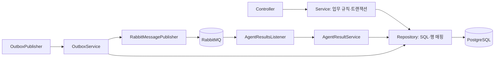

# Backend

A2 담당입니다. Java 21, Spring Boot 3.5.7, Maven을 사용합니다.
인증·요청·지정 승인·상태·이력·내 담당 요청 집계과 RabbitMQ outbox/inbox를 관리합니다.
DB 스키마와 데모 데이터는 Flyway V1~V4에 있습니다. 적용된 마이그레이션은 수정하지 않습니다.
V4는 사용자별 HTTP 접수 키의 UNIQUE 인덱스를 추가합니다. 기존 요청의 키는 null로 유지합니다.

이 폴더에서 실행합니다. 로컬 DB·RabbitMQ와 환경변수가 필요합니다.

```sh
mvn test
mvn package -DskipTests
mvn spring-boot:run
```

구조 변경 전후 회귀 검증은 Docker를 실행한 뒤 아래 명령을 사용합니다.
Testcontainers가 별도의 PostgreSQL·RabbitMQ를 만들고 종료 시 제거합니다. 기존 실행 환경의 DB는 사용하지 않습니다.

```sh
mvn verify -Pregression
# 로컬 Docker에서 API 버전 오류가 발생하는 경우:
mvn verify -Pregression -Dapi.version=1.44
```

`src/test/java/com/unlockops/regression/BackendRegressionIT.java`는 원본 코드에서 작성·통과시킨
HTTP·DB·실제 큐 계약 테스트입니다. 애플리케이션 내부 클래스와 메서드에 의존하지 않으며,
리팩토링 뒤에도 동일한 테스트로 검증합니다. 기본 `mvn test`는 Docker 없이 단위 테스트만 실행합니다.
회귀 프로필은 Docker가 없으면 실패하므로 검증 누락을 성공으로 처리하지 않습니다.
Python worker 대신 결과 JSON을 발행하므로 실제 Agent/MCP 권한 부여의 전체 스택 테스트는 별도로 필요합니다.

접수 멱등성은 `ProblemSubmissionIT`의 실제 DB 동시 트랜잭션·충돌·롤백과
`ProblemSubmissionRestartIT`의 서버 두 번 기동·재로그인으로 검증합니다. 최초 키 점유 트랜잭션의 롤백 후 후행 요청의 성공도 확인합니다.
소비자 없는 분석 큐의 전달 횟수 대신 DB에 생성된 요청·ANALYZE outbox 개수를 검증합니다.

루트 .env가 Maven에 자동 전달되지는 않습니다. VS Code의 Spring Boot 구성은 루트 .env를 읽습니다.
터미널에서 데모를 실행하면 `DEMO_ENABLED=true`, `DEMO_PASSWORD`와 DB·RabbitMQ 변수를 전달해야 합니다.
전체 컨테이너 실행은 루트 `docker compose up --build`를 사용합니다.

[API·메시지 계약](../docs/contracts/README.md), [디버깅 안내](../docs/debugging.md).

## 코드 구조

`src/main/java/com/unlockops` 아래를 업무별로 나눕니다. 최상위에는 `Application`만 둡니다.

| 패키지 | 책임과 읽기 시작점 |
| --- | --- |
| `auth` | `AuthController` → `AuthService` → `UserRepository`. 로그인·프로필·사용자 정보. `bootstrap/DemoSeed`는 데모 비밀번호 초기화 |
| `problem` | `ProblemController` → `ProblemService` → `ProblemRepository` / `ProblemEventRepository`. 접수·조회·승인/반려·이력 |
| `approval` | `ApprovalsController` → `ApprovalService` → `ApprovalRepository`. 내 담당 요청의 KST 주간 집계 |
| `grant` | `GrantPolicy` → `UserRepository` / `GrantRepository`. 지정 승인자·직급·직무·TF·부서·예산·좌석·계획 검증 |
| `resource` | `InternalResourceController` → `ResourceService` → `ResourceRepository`. 내부 API에서 플랫폼별 대상 자원 이름·별칭 검색 |
| `access` | `InternalAccessContextController` / `InternalAccessVerificationController` → Service → `AccessContextRepository` / `GrantRepository`. 접근 조건 묶음 조회와 최신 권한 반영 검증. `AccessCeilingPolicy`는 회사 권한표의 상한 조회 |
| `messaging` | `AgentResultsListener` → `AgentResultService` → Repository. `OutboxPublisher` → `OutboxService` → `OutboxRepository` / `RabbitMessagePublisher` |
| `config` | 세션·CSRF·인증 설정과 RabbitMQ 토폴로지·JSON 변환기 |
| `common` | 헬스 체크, JSON 직렬화·계획 해시, 공통 오류 DTO·예외 응답 |

각 업무 안의 `controller`는 HTTP 입력 검증·인증 주체·응답 전달, `service`는 업무 규칙과 트랜잭션,
`repository`는 SQL·행 매핑만 담당합니다. 요청/응답/메시지 계약은 `dto`, 저장 모델·고정 타입은 `model`에 둡니다.
컨트롤러·리스너·스케줄러에는 SQL이 없습니다. 인터페이스가 필요하지 않은 Repository는 구현 클래스 하나로 유지합니다.



## 요청 처리 흐름

1. `ProblemService.create`: 로그인 사용자 범위의 접수 키가 있으면 기존 수락 응답을 재사용하고 본문 충돌은 409로 처리합니다.
   새 요청의 담당자를 배정하고 원자적 INSERT에 성공한 경우에만 ANALYZE outbox를 같은 트랜잭션에 저장합니다.
2. `OutboxService.publishPending`: 최대 20건을 `FOR UPDATE SKIP LOCKED`로 잠그고 발행합니다. 브로커 confirm·라우팅을 확인한 뒤 published_at을 기록합니다. 배치 실패 시 트랜잭션을 롤백합니다.
3. `AgentResultService.apply`: inbox 중복 검사 → 요청 행 잠금 → 원본 감사 이벤트 저장 → 현재 상태에 맞는 전이 검사를 같은 트랜잭션에서 수행합니다. 지연된 분석은 승인·완료 상태를 덮어쓰지 못합니다.
4. 승인 대기 결과는 6개 필드의 `GrantPlan`, `GrantPolicy`, 비어 있지 않은 evidence를 검증합니다. 실패하면 기존처럼 MANUAL_REVIEW로 전환하고 실행 필드를 비웁니다.
5. `ApprovalDecisionService.decide`: 지정 승인자·본인 승인 금지·현재 카드 해시·최신 자격을 검사하고 사람 결정을 기록합니다. `ApprovedExecutionService`가 저장된 승인 완료 여부·계획 해시·실행 키를 확인한 뒤 EXECUTING 전이와 EXECUTE outbox를 처리합니다. 결정·이력·전이·outbox는 한 트랜잭션이며, 반려에는 사유가 필요합니다.
6. 실행 결과는 사람 결정·승인 계획을 보존합니다. 실행 DONE에는 result_type=ACCESS_VERIFIED, verification_ok=true와 해당 실행 키의 grant_receipts가 필요합니다. 분석의 안내 완료는 DONE / result_type=GUIDANCE이며 계획·verification_ok는 null입니다. 검증 실패 시 inbox와 감사 이벤트까지 함께 롤백합니다.

## 타입과 공개 응답 경계

- API 요청/응답, JobMessage, AgentEvent, AgentResult, GrantPlan, DB 행은 명시적인 record를 사용합니다. `Map<String, Object>`를 레이어 사이에 전달하지 않습니다.
- 플랫폼·상태·사용자 역할·직급·직무·자원 범위·보안 등급·SaaS 역할·작업·이벤트·Agent 모드는 enum으로 관리합니다. 한국어 직급과 `Write`, `Can view`, `demo` 등의 외부 표기는 유지합니다.
- worker가 확장하는 reasonCode/error_code는 문자열로 유지하고, 백엔드가 만드는 고정 코드는 `ServerReason`으로 관리합니다.
- 자료마다 필드가 다른 evidence, progress details, 변경하면 안 되는 원본 감사 envelope는 `JsonNode`로 유지합니다. 실행 계획은 추가·누락·null 필드를 거부하는 DTO로 별도 변환합니다.
- 요청자 응답은 `ProblemResponses.Requester`의 명시적인 허용 목록을 사용합니다. 공개 이력은 `ProblemViews`가 새 `{message}` DTO로 만들며 원본 payload를 재사용하지 않습니다. 본인이 APPROVER여도 이 경계를 적용합니다.
- 담당자 목록과 내부 상세는 별도 DTO를 사용합니다. DB 모델이나 내부 필드 추가가 요청자 응답을 확장하지 않습니다.
- `GrantPlan`의 정렬된 6개 JSON 필드로 Python과 동일한 SHA-256을 계산합니다. 구 결과의 ON_HOLD / INSUFFICIENT_BUDGET은 상태 반영 때만 정규화하고 원본 감사 기록은 유지합니다.

## 결과 메시지 재시도와 DLQ

`MessageRetryConfig`는 기존 listener 재시도에 `MessageFailureClassifier`를 적용합니다.
업무 상태나 예외 메시지 문자열 대신 예외 타입과 JDBC SQLSTATE의 원인 체인을 확인합니다.

| 오류 | 처리 |
| --- | --- |
| 명시적인 일시 DB 예외, 연결 장애, serialization/deadlock/잠금·쿼리 타임아웃 | 최초 포함 최대 3회 시도. 기본 대기 1초·2초 |
| 메시지 변환·필수 입력·결과 상태·완료 조건 위반 | 최초 실패 후 바로 `unlockops.dead` |
| DB 무결성·인증·SQL 문법 등 명확한 비일시 오류 | 최초 실패 후 바로 `unlockops.dead` |
| 그 외 미분류 오류 | 일시 오류로 추정하지 않고 바로 `unlockops.dead` |

시도 횟수·대기는 기존 `spring.rabbitmq.listener.simple.retry` 설정을 사용합니다.
인증 실패가 pool timeout에 감싸져도 인증 오류를 우선하며, DB와 무관한 네트워크 오류를 무조건 재시도하지 않습니다.
계획 형식·정책 위반·사라진 자원은 기존 `MANUAL_REVIEW`로 처리하지만, 계획 검증 중 DB 장애와 예상하지 못한 결함은
이 상태로 삼키지 않고 트랜잭션을 롤백한 뒤 재시도 정책에 전달합니다.

재시도는 listener 바깥에서 수행하므로 매 시도마다 Service 트랜잭션을 새로 시작합니다.
실패한 inbox·감사 이력·상태 변경은 함께 롤백되고, 정상 반환 후에만 기존 Spring AUTO ACK가 적용됩니다.
`RESULT_ATTEMPT_FAILED`에는 UUID·시도 횟수·분류를, `RESULT_RETRY_FINISHED`에는 총 시도와
`HANDLED`/`REJECTED`를 기록합니다. `HANDLED`는 중복/지연 이벤트를 포함한 소비 처리 정상 반환이며 업무 DONE과 별개입니다.

프로세스가 ACK 전에 종료되면 미확인 메시지는 원래 큐로 재전달됩니다. 이 동작과 처리 실패 후 DLQ 이동을 구분합니다.
DLQ 자동 재발행·parking 큐·FAILED 업무 재실행은 추가하지 않습니다. DLQ는 원인 수정·담당자 확인 후 재처리 또는 종료할 대상입니다.
재시도 소진/검증 거절만으로 `problems.status`를 바꾸지 않아 `RECEIVED`/`EXECUTING` 등이 유지될 수 있습니다.

`MessageRetryIT`는 일회용 PostgreSQL trigger에서 실제 SQL 오류를 발생시키고, 롤백에도 유지되는 sequence로 처리 횟수를 측정합니다.
일시 장애 복구·영구/미분류 거절·재시도 소진·완료 검증·중복 및 원본 메시지 보존을 확인합니다.
브라우저 자동 캡처는 [재현 절차](../docs/messaging-retry.md)를 따릅니다. 캡처는 선택 실행이며 기본 회귀에 브라우저가 필요하지 않습니다.

## 내부 자원 검색 API

`POST /internal/resources/resolve`는 서비스 간 호출용입니다. `INTERNAL_API_TOKEN`을 설정하고
`Authorization: Bearer <INTERNAL_API_TOKEN>`으로 호출합니다. `MCP_TOKEN`처럼 로컬 기본값은
`replace-this-local-internal-api-token`입니다. 배포 시 별도 비밀값으로 교체합니다.
Spring에 명시적으로 빈 값을 설정하면 내부 호출을 거부합니다. Compose는 빈 값도 로컬 기본값으로 대체합니다.
브라우저 로그인 세션으로는 접근할 수 없으며, 내부 API 체인에만 CSRF를 적용하지 않습니다.
기존 `/api/**`의 세션·CSRF 설정은 유지합니다. 내부 경로는 화면 프록시에 추가하지 않습니다.

입력은 `{ "platform": "GITHUB", "hint": "payment-core에 push가 안 됩니다" }`이며,
응답은 `{ "matches": [...], "ambiguous": false }`입니다. 후보는 외부 ID 순으로 반환합니다.
이름·외부 ID·별칭의 대소문자를 구분하지 않고 완전 일치를 우선합니다. 문장 내 포함 검색은
3글자 이상 이름에만 적용하고, 영문 자원명에는 경계를 검사합니다. 후보 0개·복수이면 ambiguous=true이며
권한 부여 여부를 판단하거나 후보를 임의 선택하지 않습니다. 빈 hint도 후보 없음으로 반환합니다.

Business MCP의 resolve_resource가 이 API를 호출하며 직접 SQL을 실행하지 않습니다.
자세한 계약은 [API 명세](../docs/api-spec.md#spring-내부-api--대상-자원-검색)를 참고하세요.

## 내부 접근 조건 묶음 조회 API

`POST /internal/access-context`는 직원·자원 ID로 분석에 필요한 사실을 조회합니다.
동일한 내부 서비스 토큰 인증을 사용하며 입력은 camelCase입니다.

```json
{"employeeId":"<직원 UUID>","resourceId":"<자원 UUID>","platform":"GITHUB"}
```

응답은 `profile`, `resource_id`, `membership`, `current`, `maximum_role`, `budget`,
`rule_source`, `source_hashes`입니다. 직원 정보는 명시한 필드만 반환하며 이메일·로그인·비밀번호를 포함하지 않습니다.
직원 ID만 보내면 직원 정보만 반환하고 자원 관련 값은 null입니다. 이때 includeBudget=true를 지정하면 부서 예산도 조회합니다.
자원 ID가 있으면 DB에서 플랫폼을 확정하며 platform을 함께 보낸 경우 일치 여부를 확인합니다.
조회는 읽기 전용 REPEATABLE_READ 트랜잭션으로 묶습니다. GitHub 저장소는 실제 모의 팀 멤버십,
Jira는 역할·조회 스킴, 나머지는 모의 SaaS 권한 테이블을 읽습니다. 자원 조회에서 예산은 SEAT일 때만 조회합니다.

권한 상한은 `data/company-a-access-matrix.md` 3절에서 읽습니다. 파일을 코드에 복사하거나
임의 상한으로 대체하지 않으며, 원문 해시도 함께 반환합니다. `ACCESS_MATRIX_PATH`로 경로를 지정할 수 있고,
로컬 기본값은 루트 또는 backend 디렉터리에서 원본 data 파일을 찾습니다. Compose는 같은 data를 읽기 전용으로 마운트합니다.

`maximum_role=""`는 규정상 신청 불가입니다. 규정을 읽거나 해석할 수 없는 경우는 503이며 빈 상한으로 대체하지 않습니다.
Notion 부서 문서의 문서상 상한이 Can edit여도 기존 자동 부여 범위가 확대되는 것은 아닙니다.
TF 비가입·다른 부서·예산 부족·승인 여부는 별도 최종 판정 항목입니다. 이 API는 권한을 부여하거나 승인하지 않습니다.
SEAT에서 `budget=null`이면 예산 미확인, 다른 자원에서는 예산 비대상입니다. 없는 직원·자원은 404,
요청 플랫폼과 실제 자원 플랫폼이 다르면 409를 반환합니다. 문서 검색·RAG 근거 반환은 이 API의 책임이 아닙니다.

Business MCP의 기존 직원·TF·현재 권한·상한·예산 도구는 이 API의 응답에서 필요한 부분을 반환합니다. Agent의 도구 입력과 노드 순서는 유지했습니다.

## 내부 승인 계획 실행 API

`POST /internal/problems/{id}/grant`는 동일한 내부 서비스 토큰을 사용합니다.
입력은 `{ "idempotencyKey": "<승인 시 서버가 발급한 실행 키>" }`뿐이며,
직원·자원·역할은 DB에 저장된 승인 계획에서만 읽습니다. 응답은 `{ "ok": true, "changed": true, "role": "Write" }`입니다.

`InternalGrantController` → `GrantExecutionService` → `GrantExecutionRepository` 구조이며,
기존 `ProblemRepository`, `GrantRepository`, `AccessContextRepository` 조회를 재사용합니다.
`GrantExecutionPolicy`는 원문 상한·현재 소속·부서·좌석·예산·근거를 실행 직전에 검증합니다.
`AccessCeilingPolicy.executionRules`는 같은 회사 권한표의 3절·7절과 인접한 `policy_corpus.md`의 해시를 읽습니다.
기존 화면 승인용 `GrantPolicy`는 유지하고 Business MCP의 grant_permission을 이 실행 API에 연결했습니다.

1. 요청 행을 잠그고 실행 키를 비교합니다. 기존 영수증이 있으면 상태가 DONE이어도 같은 결과를 반환합니다.
2. 사람 승인·EXECUTING·결정 시각·결정자·승인 계획 해시와 요청자·플랫폼·대상·역할 일치를 확인합니다.
3. Python과 같은 직원·자원 advisory lock을 잡고 현재 사실·지정 승인자의 앱 역할·직급을 재조회합니다.
4. Jira 요청 역할의 조회 스킴, 현재 자격, 문서별 근거의 원문 버전, 좌석 중복·예산을 검증합니다. 좌석 예산 행은 FOR UPDATE로 잠급니다.
5. 필요한 경우에만 GitHub 팀 가입·권한 upsert·예산 차감을 수행하고 실행 영수증을 저장합니다.

전체는 READ_COMMITTED 트랜잭션입니다. 영수증 저장을 포함해 실패하면 모두 롤백합니다.
같은 키의 재호출은 원래 영수증을 반환하므로 중복 변경·차감이 없습니다. 이미 필요한 비좌석 권한을 보유했으면
`changed=false` 영수증만 저장합니다. 다른 요청의 중복 좌석은 기존 MCP와 동일하게 거절합니다.
Jira 실패 시연은 503·재시도 가능으로 반환하고 영수증을 저장하지 않습니다.

이 API 성공은 모의 권한 변경과 영수증 저장 성공입니다. 실제 반영 재조회나 DONE 전환은 하지 않으며 기존 worker 결과 처리 흐름을 유지합니다.
상세 응답·오류는 [API 명세](../docs/api-spec.md#spring-내부-api--승인된-계획-실행)를 참고하세요.
DB 동시성·롤백 통합 테스트는 Docker를 실행한 뒤 `mvn verify -Pregression -Dit.test=GrantExecutionIT`로 실행합니다.

## 내부 최신 권한 검증 API

`POST /internal/access-verifications`는 동일한 내부 서비스 토큰을 사용합니다.

```json
{"employeeId":"<직원 UUID>","resourceId":"<자원 UUID>","platform":"GITHUB","requestedRole":"Write"}
```

`InternalAccessVerificationController` → `AccessVerificationService` → 기존 `GrantRepository` / `AccessContextRepository`로 처리합니다.
분석 State나 실행 영수증을 사용하지 않고 매 호출 독립된 읽기 전용 REPEATABLE_READ 트랜잭션(REQUIRES_NEW)에서 현재 권한을 재조회합니다.
응답은 `{ "ok": true, "verified": true, "current": { "role": "Write", "source": "github-team-membership", "teams": ["<팀 ID>"] } }` 형식입니다.

권한이 없거나 부족하면 정상 조회 응답으로 `ok=true, verified=false`를 반환합니다. Jira는 역할 외에 can_browse=true여야 합니다.
역할 비교는 `ResourceRolePolicy`를 실행 전 기존 권한 확인과 공유합니다. GitHub Write는 Read, Jira Developer는 Viewer,
Notion Can edit는 Can view를 충족하지만 서로 다른 서비스 역할이나 저장소 권한과 좌석은 비교하지 않습니다.
Can edit 검증을 지원해도 기존 자동 부여 범위는 확대하지 않습니다.

직원·자원이 없으면 404, 플랫폼 불일치는 409, 조회 장애는 500으로 반환하고 검증 실패(false)로 숨기지 않습니다.
이 API는 권한·예산·영수증·작업 상태를 변경하거나 재실행·재시도를 수행하지 않습니다. 기존 worker의 검증 재시도 및 최종 결과 처리는 유지합니다.
Business MCP verify_permission이 이 API를 호출합니다. platform은 기존 MCP 입력에 없으므로 생략 가능하며 실제 자원에서 확정합니다.
실제 서비스는 모의 SaaS 테이블 기준이며 외부 SaaS API를 호출하지 않습니다.

## Phase 2 서버 베이스라인

구현 의도·변경 이력은 [IMPLEMENTATION.md](../IMPLEMENTATION.md)에 누적합니다.
공개 API 계약은 [contracts/phase2/http.json](../contracts/phase2/http.json), 메시지·내부 API 설명은
[contracts/phase2/README.md](../contracts/phase2/README.md)를 확인하세요.

- 신규 회사의 승인 요청은 `/api/v2/problems`를 사용합니다. 기존 세션·CSRF 인증을 그대로 사용합니다.
- `/api/reclaim/runs` POST만 수동 점검을 시작합니다. GET은 저장된 결과를 조회합니다.
- V7까지 migration 후 `data/phase2/seed.sql`을 local/demo DB에 명시적으로 적용합니다. 자동 seed가 아닙니다.
- 수동 점검·모의 권한 부여에는 `DEMO_ENABLED=true`가 필요합니다. 시연 계정 비밀번호는 기존 DemoSeed가 설정합니다.
- `PHASE2_RECLAIM_SCHEDULE_ENABLED=false`가 기본입니다. v2 Worker 연결 후 이 설정과 각 `reclaim_scopes.enabled`를 켜면 매일 09:00 KST에 점검을 접수합니다.
- 새 큐는 `unlockops.v2.analysis`, `unlockops.v2.execution`입니다. 결과는 기존 `unlockops.results`에서 버전별로 처리합니다.
- **3단계 Worker가 v2 큐를 소비합니다.** Agent·Business/Policy MCP·서버 API를 연결했으며 실제 DB·RabbitMQ 전체 스택 검증은 아직 남아 있습니다. 승인 분석 해시가 서버의 최신 계획과 다르면 수동 검토로 전환합니다.
- v2의 모의 SaaS 상태는 `mock_entitlement_memberships`에 저장하며 기존 v1 GitHub 팀/Jira 권한 writer와 공유하지 않습니다.
- 이번 단계의 실제 PostgreSQL 통합 실행은 Docker 미실행으로 확인하지 못했습니다. DB 적용 전 통합 검증이 남아 있습니다.

### 4단계 화면 조회 연결

로그인/profile 응답에 회사 기준 workflow_version과 담당 권한 기준 can_reclaim을 추가했습니다.
GET /api/v2/problems/catalog는 현재 회사 자원·권한 항목, GET /api/v2/problems/summaries는 기존 ACL의 화면용 목록을 제공합니다.
기존 목록 응답은 유지하고 report에 요청자·승인자 이름, 자원·권한 표시값, 접수 시각을 추가했습니다.
새 migration은 없습니다. 프론트와 서버를 함께 갱신해야 새 회사의 v2 진입 정보와 화면 조회를 사용할 수 있습니다.
