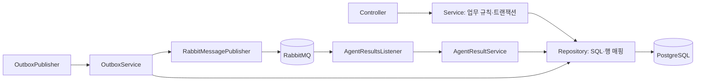

# Backend

A2 담당입니다. Java 21, Spring Boot 3.5.7, Maven을 사용합니다.
인증·요청·지정 승인·상태·이력·내 담당 요청 집계과 RabbitMQ outbox/inbox를 관리합니다.
DB 스키마와 데모 데이터는 Flyway V1~V4에 있습니다. 적용된 마이그레이션은 수정하지 않습니다.
V4는 사용자별 HTTP 접수 키의 UNIQUE 인덱스를 추가합니다. 기존 요청의 키는 null로 유지합니다.

이 폴더에서 실행합니다. 로컬 DB·RabbitMQ와 환경변수가 필요합니다.

```sh
mvn test
mvn package -DskipTests
mvn spring-boot:run
```

구조 변경 전후 회귀 검증은 Docker를 실행한 뒤 아래 명령을 사용합니다.
Testcontainers가 별도의 PostgreSQL·RabbitMQ를 만들고 종료 시 제거합니다. 기존 실행 환경의 DB는 사용하지 않습니다.

```sh
mvn verify -Pregression
# 로컬 Docker에서 API 버전 오류가 발생하는 경우:
mvn verify -Pregression -Dapi.version=1.44
```

`src/test/java/com/unlockops/regression/BackendRegressionIT.java`는 원본 코드에서 작성·통과시킨
HTTP·DB·실제 큐 계약 테스트입니다. 애플리케이션 내부 클래스와 메서드에 의존하지 않으며,
리팩토링 뒤에도 동일한 테스트로 검증합니다. 기본 `mvn test`는 Docker 없이 단위 테스트만 실행합니다.
회귀 프로필은 Docker가 없으면 실패하므로 검증 누락을 성공으로 처리하지 않습니다.
Python worker 대신 결과 JSON을 발행하므로 실제 Agent/MCP 권한 부여의 전체 스택 테스트는 별도로 필요합니다.

접수 멱등성은 `ProblemSubmissionIT`의 실제 DB 동시 트랜잭션·충돌·롤백과
`ProblemSubmissionRestartIT`의 서버 두 번 기동·재로그인으로 검증합니다. 최초 키 점유 트랜잭션의 롤백 후 후행 요청의 성공도 확인합니다.
소비자 없는 분석 큐의 전달 횟수 대신 DB에 생성된 요청·ANALYZE outbox 개수를 검증합니다.

루트 .env가 Maven에 자동 전달되지는 않습니다. VS Code의 Spring Boot 구성은 루트 .env를 읽습니다.
터미널에서 데모를 실행하면 `DEMO_ENABLED=true`, `DEMO_PASSWORD`와 DB·RabbitMQ 변수를 전달해야 합니다.
전체 컨테이너 실행은 루트 `docker compose up --build`를 사용합니다.

[API·메시지 계약](../docs/contracts/README.md), [디버깅 안내](../docs/debugging.md).

## 코드 구조

`src/main/java/com/unlockops` 아래를 업무별로 나눕니다. 최상위에는 `Application`만 둡니다.

| 패키지 | 책임과 읽기 시작점 |
| --- | --- |
| `auth` | `AuthController` → `AuthService` → `UserRepository`. 로그인·프로필·사용자 정보. `bootstrap/DemoSeed`는 데모 비밀번호 초기화 |
| `problem` | `ProblemController` → `ProblemService` → `ProblemRepository` / `ProblemEventRepository`. 접수·조회·승인/반려·이력 |
| `approval` | `ApprovalsController` → `ApprovalService` → `ApprovalRepository`. 내 담당 요청의 KST 주간 집계 |
| `grant` | `GrantPolicy` → `UserRepository` / `GrantRepository`. 지정 승인자·직급·직무·TF·부서·예산·좌석·계획 검증 |
| `messaging` | `AgentResultsListener` → `AgentResultService` → Repository. `OutboxPublisher` → `OutboxService` → `OutboxRepository` / `RabbitMessagePublisher` |
| `config` | 세션·CSRF·인증 설정과 RabbitMQ 토폴로지·JSON 변환기 |
| `common` | 헬스 체크, JSON 직렬화·계획 해시, 공통 오류 DTO·예외 응답 |

각 업무 안의 `controller`는 HTTP 입력 검증·인증 주체·응답 전달, `service`는 업무 규칙과 트랜잭션,
`repository`는 SQL·행 매핑만 담당합니다. 요청/응답/메시지 계약은 `dto`, 저장 모델·고정 타입은 `model`에 둡니다.
컨트롤러·리스너·스케줄러에는 SQL이 없습니다. 인터페이스가 필요하지 않은 Repository는 구현 클래스 하나로 유지합니다.



## 요청 처리 흐름

1. `ProblemService.create`: 로그인 사용자 범위의 접수 키가 있으면 기존 수락 응답을 재사용하고 본문 충돌은 409로 처리합니다.
   새 요청의 담당자를 배정하고 원자적 INSERT에 성공한 경우에만 ANALYZE outbox를 같은 트랜잭션에 저장합니다.
2. `OutboxService.publishPending`: 최대 20건을 `FOR UPDATE SKIP LOCKED`로 잠그고 발행합니다. 브로커 confirm·라우팅을 확인한 뒤 published_at을 기록합니다. 배치 실패 시 트랜잭션을 롤백합니다.
3. `AgentResultService.apply`: inbox 중복 검사 → 요청 행 잠금 → 원본 감사 이벤트 저장 → 현재 상태에 맞는 전이 검사를 같은 트랜잭션에서 수행합니다. 지연된 분석은 승인·완료 상태를 덮어쓰지 못합니다.
4. 승인 대기 결과는 6개 필드의 `GrantPlan`, `GrantPolicy`, 비어 있지 않은 evidence를 검증합니다. 실패하면 기존처럼 MANUAL_REVIEW로 전환하고 실행 필드를 비웁니다.
5. `ProblemService.decide`: 지정 승인자·본인 승인 금지·현재 카드 해시·최신 자격·계획 해시를 다시 검증합니다. 승인 시 사람 결정·이력·EXECUTE outbox를 한 트랜잭션에 저장합니다. 반려에는 사유가 필요합니다.
6. 실행 결과는 사람 결정·승인 계획을 보존합니다. DONE에는 verification_ok=true와 해당 실행 키의 grant_receipts가 필요합니다. 검증 실패 시 inbox와 감사 이벤트까지 함께 롤백합니다.

## 타입과 공개 응답 경계

- API 요청/응답, JobMessage, AgentEvent, AgentResult, GrantPlan, DB 행은 명시적인 record를 사용합니다. `Map<String, Object>`를 레이어 사이에 전달하지 않습니다.
- 플랫폼·상태·사용자 역할·직급·직무·자원 범위·보안 등급·SaaS 역할·작업·이벤트·Agent 모드는 enum으로 관리합니다. 한국어 직급과 `Write`, `Can view`, `demo` 등의 외부 표기는 유지합니다.
- worker가 확장하는 reasonCode/error_code는 문자열로 유지하고, 백엔드가 만드는 고정 코드는 `ServerReason`으로 관리합니다.
- 자료마다 필드가 다른 evidence, progress details, 변경하면 안 되는 원본 감사 envelope는 `JsonNode`로 유지합니다. 실행 계획은 추가·누락·null 필드를 거부하는 DTO로 별도 변환합니다.
- 요청자 응답은 `ProblemResponses.Requester`의 명시적인 허용 목록을 사용합니다. 공개 이력은 `ProblemViews`가 새 `{message}` DTO로 만들며 원본 payload를 재사용하지 않습니다. 본인이 APPROVER여도 이 경계를 적용합니다.
- 담당자 목록과 내부 상세는 별도 DTO를 사용합니다. DB 모델이나 내부 필드 추가가 요청자 응답을 확장하지 않습니다.
- `GrantPlan`의 정렬된 6개 JSON 필드로 Python과 동일한 SHA-256을 계산합니다. 구 결과의 ON_HOLD / INSUFFICIENT_BUDGET은 상태 반영 때만 정규화하고 원본 감사 기록은 유지합니다.

이번 작업은 구조와 검증 기준을 정리합니다. RabbitMQ의 재시도·DLQ·장애 복구 정책 개선은 후속 작업입니다.
