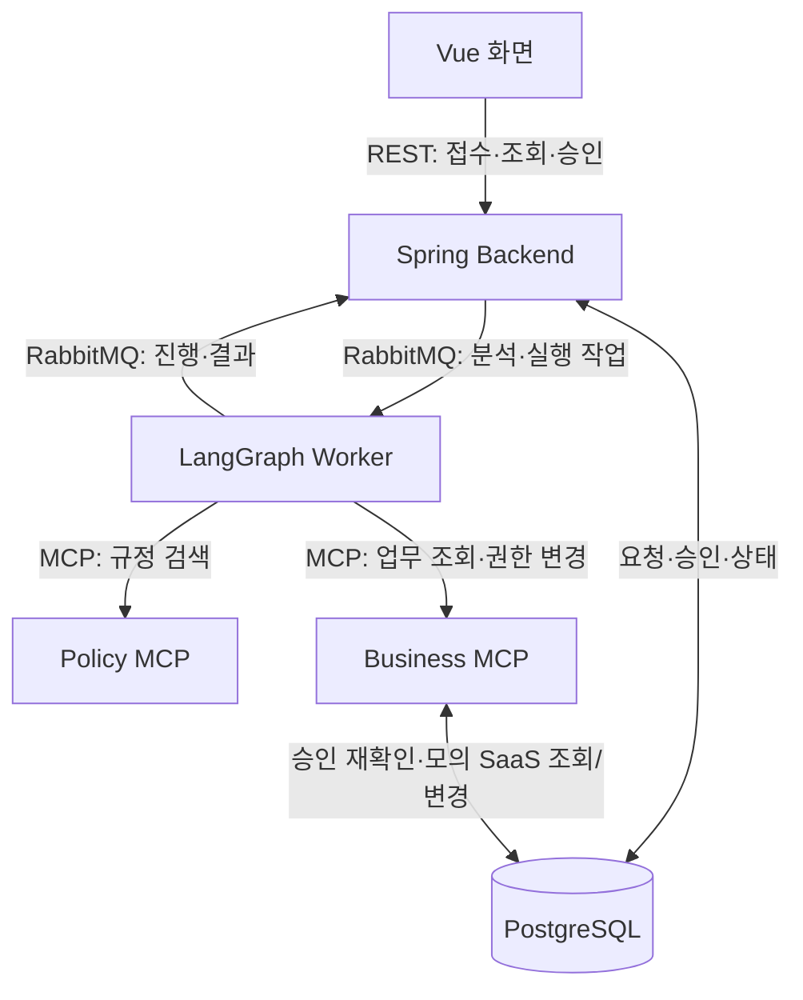

# UnlockOps 간략 API 명세서

기준: 2026-10-20 현재 작업 폴더의 구현 코드. 실행 중인 서버를 호출한 결과가 아니라 코드에서 확인한 계약이다.
아래 예시의 `<요청 UUID>`, `<직원 UUID>`, `<자원 UUID>`, `<계획 해시>`는 실제 조회값으로 바꾼다.

## 1. 서버와 MCP의 역할

**Spring은 사용자와 승인 업무를 관리하고, MCP는 에이전트에 조회·실행 도구를 제공한다.**
MCP도 서버 프로세스다. 이 문서에서 “서버 API”는 화면이 호출하는 Spring REST API를 뜻한다.

| 구분 | 호출하는 쪽 | 담당 기능 | 데이터 접근 |
| --- | --- | --- | --- |
| Spring Backend | Vue 화면 | 로그인, 요청 접수·조회, 사람의 승인·반려, 최종 상태·이력 저장 | PostgreSQL의 사용자·요청·승인·이력 |
| LangGraph Worker | RabbitMQ 작업 큐 | 질문 분석, MCP 도구 호출, 정책 판정, 승인 대기·재개, 실행·검증 순서 제어 | SQLite 체크포인트. 업무 DB 직접 변경 없음 |
| Policy MCP | LangGraph Worker | 공통·플랫폼 규정 검색 및 원문 조회 | `data/policy_corpus.md` |
| Business MCP | LangGraph Worker | 직원·권한·예산 조회, 회사 규정 검색, 승인된 권한 변경·검증 | PostgreSQL의 모의 SaaS 테이블 및 `data/company-a-access-matrix.md` |

**현재 Business MCP는 Spring REST API를 거치지 않고 같은 PostgreSQL에 직접 접근한다.**
실제 GitHub/Jira/Slack/Notion 외부 API 연동은 모의 SaaS DB로 구현되어 있다.
Spring이 사람의 승인과 요청 상태를 기록하고, Business MCP가 실행 직전 승인 기록과 조건을 다시 확인한다.



## 2. Spring REST API — 화면용

전체 Compose 실행 시 화면과 API의 기준 주소는 `http://localhost:8088`이다.
`/api/*`가 내부 Spring `8080`으로 프록시된다. 단독 Spring 실행의 기본 주소는 `http://localhost:8080`이다.

- 인증: 로그인 세션 쿠키. POST에는 CSRF 헤더가 필요하며 **로그인 POST도 포함**한다.
- 먼저 `GET /api/auth/csrf`의 `headerName`과 `token`을 받아 이후 POST 헤더에 넣고 쿠키를 유지한다.
- 요청 JSON은 주로 camelCase, 응답의 DB 필드는 주로 snake_case다. 아래 필드명을 그대로 사용한다.
- 플랫폼: `GITHUB / JIRA / SLACK / NOTION`. 승인 담당자는 `APPROVER` 역할과 과장 이상 직급을 만족해야 한다.

| Method / Path | Request | 정상 Response | 접근 범위 |
| --- | --- | --- | --- |
| `GET /api/health` | 없음 | `200 {"status":"UP"}` | 로그인 전 가능 |
| `GET /api/auth/csrf` | 없음 | `200 {"token":"…","headerName":"X-XSRF-TOKEN"}` | 로그인 전 가능 |
| `POST /api/auth/login` | `{"loginId":"kim_dev","password":"…"}` | `200 User` + 세션 쿠키 | 로그인 전 가능. CSRF 필요 |
| `GET /api/auth/me` | 세션 쿠키 | `200 User` | 로그인 사용자 |
| `POST /api/auth/logout` | 본문 없음 | `204` 본문 없음 | 세션·CSRF 사용 |
| `POST /api/problems` | `platform`, `contents`, 선택 `simulateJiraFailure`. 선택 헤더 `Idempotency-Key` | `202 {"id":"<요청 UUID>","status":"RECEIVED"}` | 로그인 사용자 |
| `GET /api/problems?mine=true` | query: `mine=true` | `200 RequesterProblem[]` | 본인 요청 최근 100건 |
| `GET /api/problems` | `mine` 생략 또는 `false` | `200 ApproverProblem[]` | 지정 승인자에게 배정된 최근 100건. 운영 담당자는 전체 열람 |
| `GET /api/problems/{id}` | path: 요청 UUID | `200 ProblemDetail` | 본인·지정 승인자·운영 담당자 |
| `POST /api/problems/{id}/decision` | `approved`, `expectedPlanHash`, `reason` | `200 {"id":"<요청 UUID>","status":"EXECUTING 또는 REJECTED"}` | 지정 승인자만. 본인 승인 불가 |
| `GET /api/approvals/summary` | 본문 없음 | `200 {"department":"개발팀","memberCount":10,"weekRequests":5,"approved":3,"rejected":1,"failed":1}` | 승인 담당자. 값은 예시 |

### 주요 요청·응답 필드

| 형식 | 필드 |
| --- | --- |
| `User` | `id`, `login_id`, `employee_no`, `name`, `role`, `job_grade`, `job_family`, `department`. 비밀번호 해시 제외 |
| 접수 Request | `platform`: 위 4개 중 하나. `contents`: 비어 있지 않은 문자열, 최대 5,000자. `simulateJiraFailure`: 기본 false, Jira 데모에서만 true 허용. 요청자는 로그인 세션에서 서버가 결정 |
| 승인 Request | `approved`: boolean. `expectedPlanHash`: 승인 카드에서 받은 `plan_hash`. `reason`: 최대 1,000자, 반려 시 필수. **승인 대기 상태이며 해시가 일치해야 처리** |
| `RequesterProblem` | `id`, `requester_id`, `approver_id`, `platform`, `contents`, `status`, `reason_code`, `diagnosis`, `proposal`, `resource_id`, `requested_role`, `decision_reason`, `decided_at`, `verification_ok`, `created_at`, `updated_at`, `requester_name`, `employee_no` |
| `ApproverProblem` | `id`, `platform`, `contents`, `status`, `reason_code`, `diagnosis`, `proposal`, `approver_id`, `requested_role`, `plan_hash`, `verification_ok`, `agent_mode`, `created_at`, `updated_at`, `requester_name`, `employee_no` |
| `ProblemDetail`: 본인 조회 | `RequesterProblem` + 공개 `events`. 이벤트는 `{kind,payload:{message},created_at}`. `plan`, `evidence`, 해시, 내부 실행 키 제외 |
| `ProblemDetail`: 담당자 조회 | 내부 요청 필드 + `plan`, `evidence`, `plan_hash`, `approved_plan_hash`, `events` 등. 본인인 승인자는 본인 조회 형식 적용 |
| 승인 집계 | 한국 시간 이번 주 월요일 00:00부터 다음 월요일 전까지 **접수된 본인 배정 요청** 기준. `approved`와 `failed`는 중복될 수 있음 |

접수 예시:

```json
{"platform":"GITHUB","contents":"payment-core에 push가 안 됩니다","simulateJiraFailure":false}
```

접수 응답:

```json
{"id":"<요청 UUID>","status":"RECEIVED"}
```

공식 UI는 접수 시 `Idempotency-Key: <접수 키>` 헤더를 전송한다. 동일 사용자의 같은 키·같은 유효 본문은
추가 작업을 만들지 않고 최초 응답을 재사용한다. 처리 상태가 진행됐어도 재전송 응답은 최초 RECEIVED이며 최신 상태는 GET으로 확인한다.
같은 키의 다른 유효 본문은 409다. 키는 1~128자의 영문·숫자·`._:-`로 제한하며 잘못된 키는 400이다.
다른 사용자·같은 키는 독립이고, 새 키 또는 키 없는 요청은 새 접수다. 헤더 없는 클라이언트는 접수 멱등성이 적용되지 않는다.
키 수명·정규화·트랜잭션 경계는 [접수 멱등성 계약](contracts/README.md#요청-접수-멱등성)을 참고한다.

승인 요청 예시:

```json
{"approved":true,"expectedPlanHash":"<계획 해시>","reason":"업무상 필요한 접근입니다."}
```

승인 응답의 `EXECUTING`은 실행 작업 접수를 뜻한다. 실제 부여·검증 완료는 상세 조회의 `DONE`과 `verification_ok`로 확인한다.

**공통 오류:** `{"message":"오류 안내"}`. 대표 HTTP 코드는 `400` 입력 오류, `401` 로그인 필요/실패,
`403` 권한 또는 CSRF 오류, `404` 요청 없음, `409` 승인 상태·계획·조건 변경, `500` 서버 오류다.

### Spring 내부 API — 대상 자원 검색

이 API만 먼저 구현했으며 Business MCP는 아직 기존 DB 조회를 사용한다.

| 항목 | 계약 |
| --- | --- |
| Method / Path | `POST /internal/resources/resolve` |
| 인증 | `Authorization: Bearer <INTERNAL_API_TOKEN>`. 로컬 기본값은 `replace-this-local-internal-api-token`. 헤더 누락·오류 토큰은 401. 브라우저 세션은 인증 수단이 아님 |
| Request | `platform`: 필수 enum, `hint`: 필수 문자열·최대 5,000자. 빈 문자열·공백은 검색 결과 없음 |
| Response | `200 {matches: Resource[], ambiguous: boolean}`. 후보 없음도 200 |
| 오류 | `400` 잘못된 입력, `401` 서비스 인증 실패, `500` 서버 오류. 기존 `{message}` 형식 |

호출 예시:

```http
POST /internal/resources/resolve
Authorization: Bearer <INTERNAL_API_TOKEN>
Content-Type: application/json

{"platform":"GITHUB","hint":"payment-core에 push가 안 됩니다"}
```

응답 예시(식별자는 설명용):

```json
{
  "matches": [{
    "id": "<자원 UUID>",
    "platform": "GITHUB",
    "external_id": "payment-core",
    "name": "결제 저장소",
    "aliases": ["결제코어"],
    "access_scope": "TF",
    "owner_department_id": null,
    "tf_id": "<TF UUID>",
    "security_grade": "INTERNAL",
    "designated_department_id": null
  }],
  "ambiguous": false
}
```

- 선택한 플랫폼의 자원만 외부 ID 순으로 검색한다. 권한 부여 자격을 판정하는 API는 아니다.
- 외부 ID·이름·별칭의 완전 일치 후보를 우선한다. 완전 일치가 없으면 문장 내 포함 후보를 반환한다.
- 포함 검색은 3글자 이상 이름만 사용하며, `[a-z0-9_-]` 이름은 앞뒤 같은 문자군과 이어진 경우 일치시키지 않는다.
- 후보가 정확히 1개일 때만 `ambiguous=false`. 0개·복수는 true이며 자동으로 하나를 선택하지 않는다.
- 내부 API는 별도 stateless 보안 체인을 사용한다. 기존 화면 API의 세션·CSRF 설정은 유지한다.
- `MCP_TOKEN`과 같은 방식으로 로컬 기본 토큰을 사용하며 배포 시 교체한다. Spring에 명시적으로 빈 토큰을 설정하면 호출을 차단한다.
- Compose는 Backend에 `INTERNAL_API_TOKEN`을 전달하지만 내부 경로를 화면 프록시에 공개하지 않는다.

### Spring 내부 API — 접근 조건 묶음 조회

| 항목 | 계약 |
| --- | --- |
| Method / Path | `POST /internal/access-context` |
| 인증 | 자원 검색과 동일한 `Authorization: Bearer <INTERNAL_API_TOKEN>`. 세션 로그인만으로 호출 불가 |
| Request | `employeeId`, `resourceId`: 필수 UUID. `platform`: 필수 플랫폼 enum |
| Response | `200 {profile,resource_id,membership,current,maximum_role,budget,rule_source,source_hashes}` |
| 오류 | `400` 입력 오류, `401` 서비스 인증 실패, `404` 직원·자원 없음, `409` 자원 플랫폼 불일치, `503` 권한표 읽기·해석 실패, `500` 기타 서버 오류. 기존 `{message}` 형식 |

요청:

```json
{"employeeId":"<직원 UUID>","resourceId":"<자원 UUID>","platform":"GITHUB"}
```

응답 예시(설명용 식별자):

```json
{
  "profile": {
    "id": "<직원 UUID>",
    "employee_no": "E-001",
    "name": "김개발",
    "department_id": "<부서 UUID>",
    "department_name": "개발팀",
    "job_grade": "사원",
    "job_family": "DEV",
    "head_id": "<부서장 UUID>"
  },
  "resource_id": "<자원 UUID>",
  "membership": {"tf_id":"<TF UUID>","member":true,"leader_id":"<리더 UUID>"},
  "current": {"role":null,"source":"github-team-membership","teams":[]},
  "maximum_role": "Write",
  "budget": null,
  "rule_source": "A-ACCESS-03",
  "source_hashes": {"company-a-access-matrix.md":"<해당 원문의 SHA-256>"}
}
```

- `current`는 GitHub 저장소에서 `teams`, Jira에서 `can_browse`를 포함한다. 나머지 경우 해당 선택 필드는 생략한다.
- GitHub 좌석은 팀 멤버십 대신 permissions를 조회한다. GitHub 팀에서 Read·Write를 함께 보유하면 Write를 반환한다.
- Jira 역할이 있어도 조회 스킴이 없거나 조회 불가이면 `can_browse=false`이며, 역할이 없어도 false이다.
- 비TF 자원의 membership은 `{tf_id:null,member:false,leader_id:null}`이다.
- SEAT일 때만 부서 예산을 조회한다. 예산이 있으면 `{department_id,remaining_monthly_amount,unit_monthly_price,currency,updated_at}`를 반환한다.
  금액은 소수점 문자열이다. 예산 행이 없으면 null이며 0이나 충분함으로 추측하지 않는다. 비SEAT도 budget은 null이다.
- `maximum_role`은 원문 3절의 직무·직급·자원별 상한이며 빈 문자열은 신청 불가이다. TF 구성원 자격·부서·예산·사람 승인을 대신하지 않는다.
- 문서의 Can edit 상한과 기존 자동 부여 범위는 다르다. 이 API는 최종 승인 가능 여부를 반환하지 않는다.
- 원문 누락·잘못된 표·중복 적용 기준·미지원 역할은 503이다. 읽은 원문과 source_hashes는 같은 파일 내용에 대응한다.
- `ACCESS_MATRIX_PATH`로 원문 경로를 지정할 수 있다. Compose에서는 기존 Python과 동일한 data를 읽기 전용으로 사용한다.
- DB 사실은 읽기 전용 REPEATABLE_READ 트랜잭션으로 수집한다. 권한 변경·예산 차감·이력·큐 작업 생성은 하지 않는다.
- 문서 청크·검색 결과는 별도의 RAG 도구 책임이다. Business MCP와 Agent의 기존 호출은 아직 변경하지 않았다.

### Spring 내부 API — 승인된 계획 실행

| 항목 | 계약 |
| --- | --- |
| Method / Path | `POST /internal/problems/{id}/grant` |
| 인증 | 동일한 `Authorization: Bearer <INTERNAL_API_TOKEN>` 서비스 인증 |
| Request | path `id`: 요청 UUID. body `idempotencyKey`: 필수·공백 불가·최대 150자. 승인 시 발급된 저장 값과 일치해야 함 |
| Response | `200 {"ok":true,"changed":boolean,"role":"Write"}`. role은 승인 계획의 역할 |
| 대상 결정 | 호출자가 직원·자원·역할을 새로 지정하지 않음. DB의 승인 계획을 사용 |

```http
POST /internal/problems/<요청 UUID>/grant
Authorization: Bearer <INTERNAL_API_TOKEN>
Content-Type: application/json

{"idempotencyKey":"<승인 시 발급된 실행 키>"}
```

- 사람 승인 상태(EXECUTING/HUMAN)·승인 시각·승인 계획 해시·현재 지정 승인자를 재확인한다.
- DB 요청의 요청자·자원·플랫폼·역할과 계획의 동일성, 현재 TF·부서·권한 상한·Jira 스킴·예산을 검증한다.
- 회사 권한표와 플랫폼 규정의 필수 문서별 근거가 최신 원문 해시와 맞아야 한다. 규정 누락·미확인 조건은 실행하지 않는다.
- 요청 행 잠금, 직원·자원 advisory lock, 좌석 예산 행 잠금을 사용한다. Python의 기존 advisory lock 키와 동일하다.
- 권한 변경·예산 차감·영수증 저장은 같은 트랜잭션이다. 오류는 예외로 전파해 전체 롤백한다.
- 같은 요청·실행 키로 이미 성공한 경우 원래 영수증을 반환한다. 이때 `changed`는 첫 실행 결과를 그대로 유지한다.
- 비좌석 자원의 권한을 이미 보유한 경우 `changed=false`이며 영수증만 저장한다. 다른 요청으로 이미 보유한 좌석은 DUPLICATE_SEAT로 차단한다.
- 성공 응답은 실제 반영 검증·DONE 전환을 대신하지 않는다. Business MCP·worker는 아직 이 API로 전환하지 않았다.

업무·실행 오류는 HTTP 오류 코드와 다음 기계 판독 응답을 함께 반환한다.

```json
{
  "ok": false,
  "error": {
    "code": "PRECONDITION_CHANGED",
    "message": "현재 부여 조건을 충족하지 않습니다.",
    "retryable": false,
    "reason": "BUDGET_INSUFFICIENT"
  }
}
```

| HTTP | code | 의미 |
| --- | --- | --- |
| 404 | `NOT_FOUND` | 대상 요청 없음 |
| 409 | `INVALID_EXECUTION_KEY` | 저장된 실행 키와 불일치 |
| 409 | `APPROVAL_REQUIRED` | 유효한 사람 승인 상태 아님 |
| 409 | `PLAN_CHANGED` / `PLAN_IDENTITY_MISMATCH` | 승인 계획·해시·요청자·대상이 일치하지 않음 |
| 409 | `APPROVER_CHANGED` / `RESOURCE_CHANGED` | 현재 승인자 자격·지정 또는 자원 정보가 변경됨 |
| 409 | `PRECONDITION_CHANGED` | reason에 TF·부서·상한·근거·좌석·예산·Jira 조건 실패 코드 포함 |
| 503 | `POLICY_SOURCE_UNAVAILABLE` | 최신 규정 원문 또는 적용 기준 확인 불가. retryable=false |
| 503 | `MOCK_JIRA_UNAVAILABLE` | 모의 Jira 일시 장애. retryable=true |
| 503 | `UPSTREAM_UNAVAILABLE` | 일시 DB 오류·연결 실패. retryable=true |

인증 실패(401), 입력 오류(400), 그 외 예상하지 못한 서버 오류(500)는 기존 `{message}` 형식을 유지한다.
사유 없는 error.reason은 생략한다. 실패 시 승인 기록을 취소하거나 요청 상태를 직접 FAILED/DONE으로 바꾸지 않는다.
문서 파일은 `ACCESS_MATRIX_PATH`의 회사 권한표와 같은 디렉터리에 있는 `policy_corpus.md`를 사용한다.

### Spring 내부 API — 최신 권한 반영 검증

| 항목 | 계약 |
| --- | --- |
| Method / Path | `POST /internal/access-verifications` |
| 인증 | 동일한 `Authorization: Bearer <INTERNAL_API_TOKEN>`. 브라우저 세션만으로 호출 불가 |
| Request | `employeeId`, `resourceId`: 필수 UUID. `platform`: 필수 플랫폼 enum. `requestedRole`: 필수 지원 역할 이름 |
| 지원 역할 | `Read / Write / Viewer / Developer / Can view / Can edit / Member / Seat`. Admin·Owner·빈 문자열은 400 |
| Response | `200 {ok:true,verified:boolean,current:{role,source,…}}` |
| 오류 | `400` 입력 오류, `401` 서비스 인증 실패, `404` 직원·자원 없음, `409` 플랫폼 불일치, `500` 조회 장애 등. 기존 `{message}` 형식 |

요청:

```json
{"employeeId":"<직원 UUID>","resourceId":"<자원 UUID>","platform":"GITHUB","requestedRole":"Write"}
```

응답 예시:

```json
{
  "ok": true,
  "verified": true,
  "current": {"role":"Write","source":"github-team-membership","teams":["<팀 ID>"]}
}
```

- 기존 State·계획의 부여 예정 권한·성공 영수증이 아닌 실제 모의 SaaS 테이블을 다시 조회한다.
- 매 호출 별도 읽기 전용 REQUIRES_NEW / REPEATABLE_READ 트랜잭션을 시작해 이전 분석 트랜잭션의 스냅샷을 재사용하지 않는다.
- `ok=true`는 조회 성공이다. 권한 부재·부족·타 역할군은 `verified=false`인 정상 200 응답이다.
- 같은 역할군 안의 상위 권한도 충족으로 처리한다: Write→Read, Developer→Viewer, Can edit→Can view.
- 좌석은 Seat만 비교하고 저장소 Read/Write와 비교하지 않는다. 서비스가 다른 역할은 순위 숫자가 같아도 충족하지 않는다.
- Jira는 역할 충족과 `current.can_browse=true`가 모두 필요하다. 조회 스킴 누락·조회 불가는 false이다.
- `current`는 기존 조회 형식을 재사용한다. GitHub 저장소는 teams, Jira는 can_browse를 포함하고 다른 선택 필드는 생략한다.
- Can edit는 기존 보유 권한의 검증을 위한 지원이며 자동 부여 가능 여부나 승인 자격을 의미하지 않는다.
- API 호출은 권한·예산·영수증·요청 상태를 변경하지 않는다. 성공만으로 DONE을 기록하지 않으며 재시도·최종 상태는 worker의 책임이다.
- DB 오류를 `verified=false`로 바꾸지 않는다. Business MCP와 Agent는 아직 이 API를 사용하지 않는다.

## 3. MCP 도구 API — 에이전트용

독립 로컬 실행: Policy `http://localhost:8001/mcp`, Business `http://localhost:8002/mcp`.
Compose 내부: `http://policy-mcp:8000/mcp`, `http://business-mcp:8000/mcp`.
기본 Compose는 MCP 포트를 호스트에 공개하지 않는다.

인증은 `Authorization: Bearer <MCP_TOKEN>`이다. 두 MCP의 `GET /health`도 같은 인증을 사용하며
성공 응답은 `{"status":"UP"}`, 인증 실패는 HTTP `401 {"error":"unauthorized"}`다.

아래 이름은 REST URL이 아니라 MCP `tools/call`에서 호출하는 **도구 이름**이다.
표의 Request는 `arguments`, Response는 MCP 응답의 `structuredContent`에 해당한다.

| 담당 | 도구 이름 | Request (`arguments`) | Response 주요 필드 | 역할 |
| --- | --- | --- | --- | --- |
| Policy MCP | `search_policy` | `query`, `platform`, 선택 `limit=5` | `{hits:[Evidence]}` | 규정 유사도 검색 |
| Policy MCP | `read_policy` | `doc_id`, 선택 `article=""` | `{chunks:[Evidence]}` | 규정 원문 조회 |
| Business MCP | `get_employee_profile` | `employee_id` | `{id,employee_no,name,department_id,department_name,job_grade,job_family,head_id}` | 직원 정보 조회 |
| Business MCP | `resolve_resource` | `platform`, `hint` | `{matches:[Resource],ambiguous:boolean}` | 저장소·프로젝트 등 대상 찾기 |
| Business MCP | `get_tf_membership` | `employee_id`, `resource_id` | `{tf_id,member:boolean,leader_id}` | TF 소속·리더 조회 |
| Business MCP | `get_current_permissions` | `employee_id`, `resource_id` | `{role:string 또는 null,source,…}`. Jira는 `can_browse`, GitHub 저장소는 `teams` 추가 | 실제 현재 권한 조회 |
| Business MCP | `check_budget` | `employee_id` | `{budget:{department_id,remaining_monthly_amount,unit_monthly_price,currency,updated_at} 또는 null}` | 부서 예산·좌석 가격 조회 |
| Business MCP | `search_access_rules` | `query`, `employee_id`, `resource_id` | `{hits:[Evidence],maximum_role,rule_source,exception_source}` | 회사 규정 검색·권한 상한 계산 |
| Business MCP | `read_access_rule` | `doc_id` | `{chunks:[Evidence]}` | 회사 규정 절 원문 조회 |
| Business MCP | `grant_permission` | `problem_id`, `idempotency_key` | `{ok:true,changed:boolean,role}` | **유일한 변경 도구**, 승인된 계획 실행 |
| Business MCP | `verify_permission` | `employee_id`, `resource_id`, `requested_role` | `{ok:true,verified:boolean,current:{role,source,…}}` | 실행 후 실제 권한 재조회 |

- `employee_id`는 Spring의 `requester_id`에 해당하는 직원 UUID다. `resource_id`, `problem_id`도 UUID다.
- `Resource`의 핵심 필드: `id`, `external_id`, `name`, `platform`, `access_scope`. 부서·기밀 자원은 관련 부서 정보 포함.
- `Evidence`의 핵심 필드: `chunk_id`, `doc_id`, `text`, `source`, `version`. 검색 점수·원문 해시 등 추가 메타데이터 가능.
- `search_policy.limit`: 정수 1~10. `query`·`hint`: 최대 5,000자. 정의되지 않은 입력 필드는 거부한다.
- `read_access_rule.doc_id`: `A-ACCESS-03/04/07`. `read_policy.doc_id`: `POL-xx` 또는 `GH/JR/SL/NT-OFF-xx` 형식.
- `requested_role`: `Read / Write / Viewer / Developer / Can view / Can edit / Member / Seat`. 실제 부여 가능 여부는 별도 규정 판정.
- 예산 금액은 `"100.00"`처럼 소수점 최대 두 자리 문자열이다. `ambiguous`는 후보가 정확히 하나일 때만 false다.
- `grant_permission`의 대상·권한은 DB에 승인된 계획에서 읽는다. 호출자가 직원·자원·역할을 따로 지정하지 않는다.
- 같은 실행 키로 재호출하면 저장된 결과를 반환한다. `changed:false`는 이미 필요한 권한을 보유해 변경하지 않은 성공도 포함한다.

MCP SDK의 연결 초기화를 마친 뒤 보내는 `tools/call` 요청 예시:

```json
{
  "jsonrpc":"2.0",
  "id":1,
  "method":"tools/call",
  "params":{
    "name":"grant_permission",
    "arguments":{"problem_id":"<요청 UUID>","idempotency_key":"<서버가 발급한 실행 키>"}
  }
}
```

정상 응답 예시 (`result.content`에도 같은 JSON 텍스트가 제공됨):

```json
{
  "jsonrpc":"2.0",
  "id":1,
  "result":{
    "isError":false,
    "structuredContent":{"ok":true,"changed":true,"role":"Write"},
    "content":[{"type":"text","text":"{\"ok\":true,\"changed\":true,\"role\":\"Write\"}"}]
  }
}
```

도구 실행 오류는 `result.isError=true`와 다음 `structuredContent`로 반환한다:

```json
{"ok":false,"error":{"code":"APPROVAL_REQUIRED","message":"Business operation was not applied","retryable":false}}
```

대표 코드: `INVALID_TOOL_INPUT`, `NOT_FOUND`, `APPROVAL_REQUIRED`, `PLAN_CHANGED`,
`INVALID_EXECUTION_KEY`, `UPSTREAM_UNAVAILABLE`, `INVALID_TOOL_OUTPUT`.
업무상 거절은 재시도하지 않고, 일시 장애는 `retryable`에 따라 한도 내에서 재시도한다.

## 4. Spring ↔ Agent 사이 — RabbitMQ 메시지

Spring이 Agent를 호출하는 HTTP API는 현재 없다. RabbitMQ로 작업과 결과를 비동기 교환한다.

| 방향·routing key | Request / Message | Response / 후속 처리 |
| --- | --- | --- |
| Spring → Worker: `analysis` | `{event_id,job_type:"ANALYZE",problem_id,requester_id,platform,contents,idempotency_key:null,plan_hash:null}` | Worker가 MCP로 분석한 뒤 `results`에 결과 발행 |
| Spring → Worker: `execution` | 같은 형식에 `job_type:"EXECUTE"`. 서버가 기록한 `idempotency_key`, `plan_hash` 포함 | 저장된 승인 대기 그래프를 재개해 권한 부여·검증 실행 |
| Worker → Spring: `results` | `{event_id,problem_id,job_type,kind,…}` | Spring이 중복·상태 전이를 검사해 DB 반영. 화면은 REST로 다시 조회 |

`kind`: `PROGRESS / ANALYZED / EXECUTED / FAILED`.
`ANALYZED`·`EXECUTED`에는 `result:{status,reasonCode,summary,diagnosis,proposal,evidence,nextAction,plan,verification_ok,agent_mode}`가,
`FAILED`에는 `error_code`가 들어간다. 자세한 envelope는 [공통 계약](contracts/README.md#rabbitmq)을 참고한다.

## 5. 전체 처리 순서

1. 화면 → Spring: `POST /api/problems`로 접수. `202 RECEIVED`를 즉시 응답한다.
2. Spring → RabbitMQ → Worker: 분석 작업을 보낸다.
3. Worker → Policy/Business MCP: 규정·직원·현재 권한 등을 조회하고 처리안을 만든다.
4. Worker → Spring: 분석 결과를 반환한다. 변경이 필요하고 부여 가능하면 `WAITING_APPROVAL`로 만든다.
5. 승인자 화면 → Spring: `POST /api/problems/{id}/decision`으로 승인·반려를 기록한다.
6. 승인 시 Spring → Worker → Business MCP: 승인 내용을 재확인해 부여하고, 재조회로 검증한다.
7. Worker → Spring: 최종 결과를 반영하고 화면에서 확인한다.

상태: `RECEIVED / DIAGNOSING / WAITING_APPROVAL / EXECUTING / DONE / REJECTED / MANUAL_REVIEW / FAILED`.
RAG 안내는 기존 서버 계약에 맞춰 `MANUAL_REVIEW / RAG_GUIDANCE`로 전달하며 proposal에 답변·출처를 담는다.
plan·verification_ok는 null이다. 화면 상태는 담당자 검토로 표시되며 안내 완료 전용 상태는 추가하지 않는다.
추가 질문용 API는 없으며 정보 부족·대상 불명확은 `MANUAL_REVIEW`, 예산 부족은 `REJECTED`로 처리한다.

구현 참조: `backend/src/main/java/com/unlockops/`의 Controller·Service·SecurityConfig,
`mcp/unlockops_mcp/`、`agent/unlockops/contracts.py`、`worker/unlockops_worker/__main__.py`、`compose.yaml`。
상세 MCP 입출력·오류 규칙은 [MCP 계약](contracts/mcp.md)을 참고한다.
