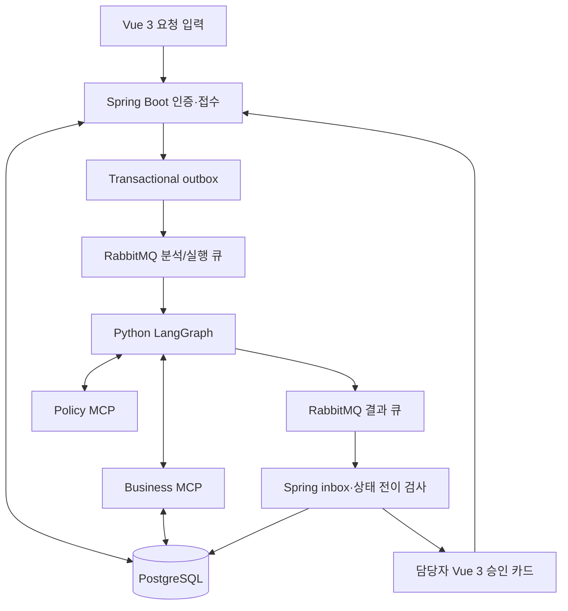
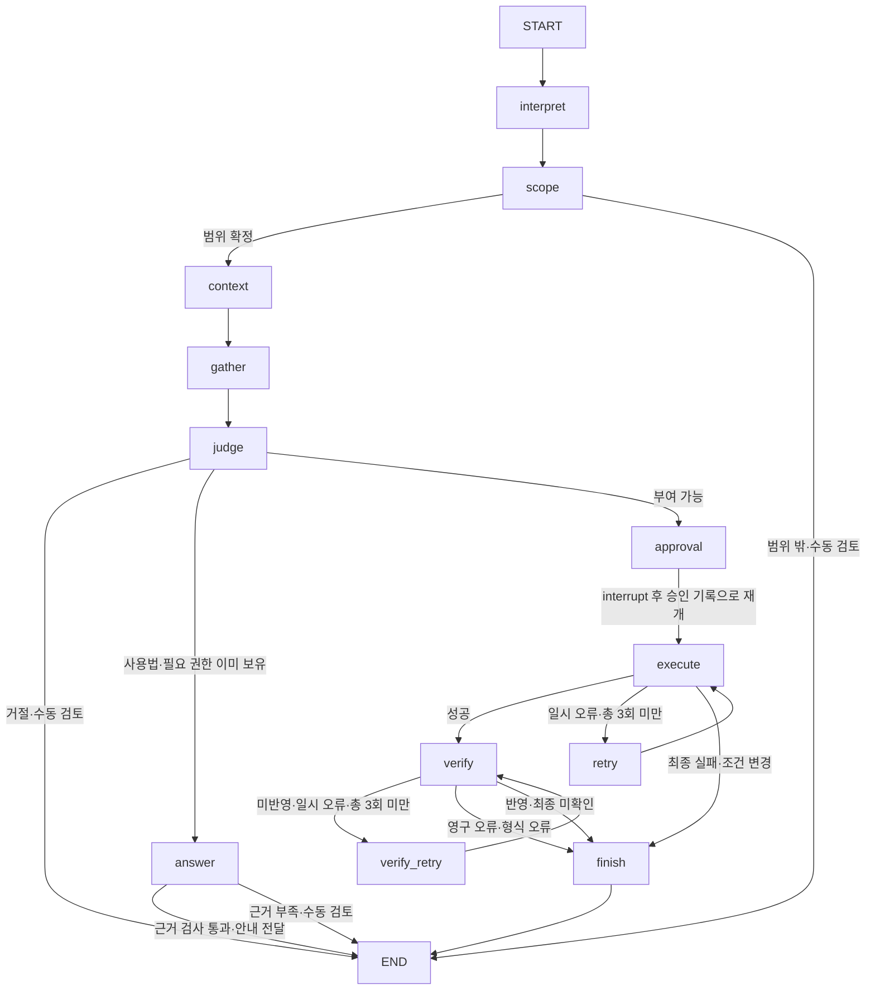

# 아키텍처와 구현 위치

Spring은 `users`/`problems`의 쓰기와 승인 기록을 소유합니다. Business MCP는 모의 SaaS의 권한·팀·예산을
변경하며, 동일 DB의 승인된 불변 계획을 읽고 다시 검증합니다. 에이전트 워커는 업무 테이블을 직접 수정하지 않습니다.
에이전트 상태는 별도 SQLite 체크포인트 볼륨에 저장합니다. 이 버전은 체크포인트 워커 한 개로 실행합니다.

State에는 원본 작업, 해석 결과, 직원 사실, 자원, TF 소속, 현재 권한, 예산, 두 문서의 근거,
불변 실행 계획, 실행·검증 시도 횟수와 진행 이벤트가 들어갑니다.
의도에는 사용법 문의·오류 해결·권한 신청을 구분하는 request_type이 있고,
판정 후 handling에는 ANSWER / APPROVAL / REJECT / MANUAL_REVIEW를 기록합니다.

답변 경로는 검색 문서와 조회 사실로 안내를 작성합니다. 데모에서는 검색 원문을 발췌하고,
LLM 모드에서는 생성 후 별도 근거 검토를 거칩니다. 코드가 인용 ID·원문 발췌의 일치도 확인합니다.
자료 부족·내용 미지원은 MANUAL_REVIEW입니다. 안내도 기존 서버 계약에 맞춰
MANUAL_REVIEW / RAG_GUIDANCE로 전달하며 proposal에 답변을 담습니다.
화면 상태는 담당자 검토로 남고 실제 오류 해결·권한 반영을 완료했다고 표현하지 않습니다.
새 상태·DB 마이그레이션은 추가하지 않으며 plan·verification_ok는 null입니다.

LLM 모드의 `planner.investigate`는 두 MCP의 도구 설명·입력 스키마를 받아 읽기 도구를 선택합니다.
`ScopedTools`는 직원·플랫폼·자원 범위와 호출 횟수를 제한합니다. 필수 조회는 선택 조회보다 먼저 코드에서
수행합니다. 실제 읽기 호출은 context를 포함해 최대 30회, 모델 선택 조회 시도는 최대 10회이며 선택 조회
한도가 소진돼도 이미 수집한 필수 근거로 판정합니다. 모델이 사실 조회를 생략하거나 근거를 문장으로
만들어도 권한 변경을 승인하지 않습니다. MCP 경계의 스키마·오류는 [공유 계약](contracts/mcp.md)으로 검증합니다.

승인 카드의 계획 SHA-256과 UI가 제출한 해시를 비교합니다. 승인 시 Spring이 조건과 승인자를 재검증하고,
Business MCP도 실행 직전 DB 승인·계획 해시·TF·직무·부서·예산을 검사합니다. 모델이나 클라이언트는 실행 도구에
사용자·자원·역할을 임의 지정할 수 없습니다. 실행 도구 입력은 `problem_id`, `idempotency_key` 두 개뿐입니다.

권한 변경·예산 차감·실행 영수증은 같은 트랜잭션으로 커밋합니다. 사용자×자원 advisory lock과
예산 row lock으로 동시 중복 부여·좌석 중복 차감을 막습니다. RabbitMQ는 중복 전달될 수 있으므로
exactly-once 전송을 주장하지 않습니다. outbox/inbox와 실행 영수증으로 처리의 중복을 제어합니다.

기술 오류는 `FAILED`, 업무상 금지는 `REJECTED`, 예산 부족은 `REJECTED / BUDGET_INSUFFICIENT`, 자원·승인자 불명확은
`MANUAL_REVIEW`입니다. 정보가 부족해도 사용자에게 추가 질문을 보내지 않습니다.

요청자는 본인 요청만 조회하며, 공개 이력은 원본 에이전트 이벤트에서 정해진 안내 문장으로 변환합니다.
원본 evidence·도구 호출·실행 계획·해시는 요청자 응답에 포함하지 않습니다.
답변의 proposal에는 사용자에게 안내할 내용과 인용 문서·청크 ID를 포함합니다. 승인 및 변경 도구의 권한 검사는 유지합니다.

구현에서 참고한 공식 자료:

- [LangGraph 승인 대기·재개](https://docs.langchain.com/oss/python/langgraph/interrupts)
- [공식 MCP Python SDK](https://github.com/modelcontextprotocol/python-sdk)
- [Spring AMQP 메시지 리스너](https://docs.spring.io/spring-amqp/reference/amqp/receiving-messages/async-annotation-driven.html)
- [Vue 공식 시작 안내](https://vuejs.org/guide/quick-start.html)
