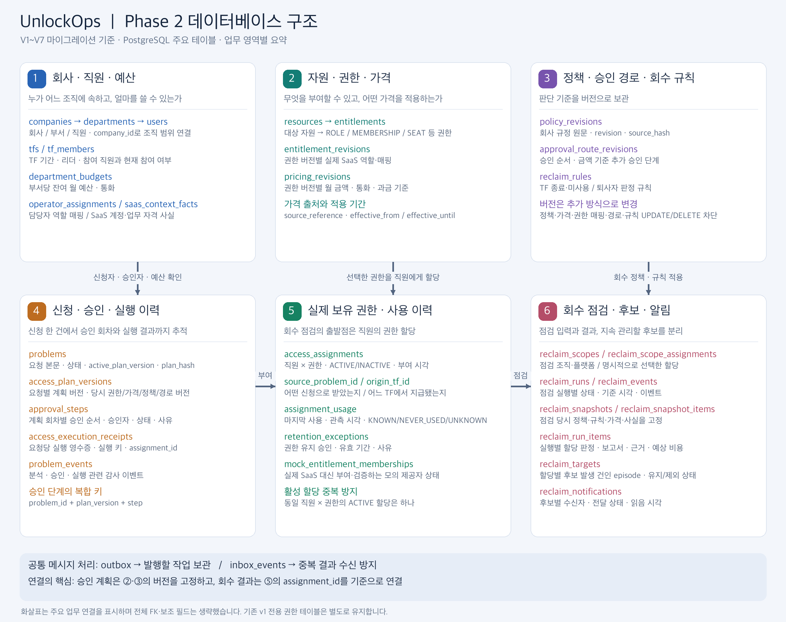

# DB 스키마 요약

## Phase 2 구조도

V1~V7 마이그레이션의 주요 테이블을 업무 영역별로 묶은 구조도입니다. 화살표는 업무 연결이며 전체 외래 키를 표시한 ERD는 아닙니다.
`entitlements`는 부여 가능한 권한 목록, `access_assignments`는 직원에게 실제 할당된 권한입니다.
승인 계획은 `access_plan_versions`에 당시 권한·가격·정책·승인 경로 버전을 고정하며, 회수 점검은 할당과 고정 스냅샷을 기준으로 결과·후보·알림을 연결합니다.
상품별 가격은 `pricing_revisions`, 부서 잔여 예산은 `department_budgets`에서 관리합니다. 현재 회수 결과의 `action_taken`은 `NONE`으로 실제 회수 실행을 의미하지 않습니다.

## 기존 스키마 및 확장 설명

실제 DDL은 `backend/src/main/resources/db/migration/V1__schema.sql`, 회사 A사 데이터는 V2에 있습니다.
상태 8개 변경과 본인 요청 목록 인덱스는 V3, HTTP 접수 멱등성 키는 V4, 완료 결과 유형과 과거 안내 성공 변환은 V5에 있습니다.
새 backend를 시작하면 Flyway가 미적용 버전을 순서대로 적용합니다. 실제 환경의 적용 여부는 Flyway 이력을 확인합니다.

기존 세 테이블을 중심으로 다음 필드와 상태 저장을 추가했습니다.

| 테이블 | 주요 필드·역할 |
|---|---|
| departments | id, name, code, head_id |
| users | 기존 필드 + employee_no, login_id, job_family. 직급 이름은 job_grade로 통일 |
| problems | 기존 필드 + result_type, reason_code, decision_source, decided_by, plan, plan_hash, approved_plan_hash, agent_mode, simulate_jira_failure, client_request_key |
| tfs / tf_members | TF 리더와 날짜, 명단의 active 상태 |
| resources | platform, external_id, aliases, access_scope, tf_id, 소유·지정 부서, security_grade |
| permissions | 모의 SaaS의 사용자×자원 단일 현재 역할 |
| github_teams / github_team_members | 저장소×역할 전용 팀과 구성원. 실제 GitHub 부여·재조회 기준 |
| jira_role_permissions | 프로젝트 역할이 실제 Browse 권한을 제공하는지 표현 |
| department_budgets | 부서별 잔여 월 예산·좌석 가격·통화 |
| problem_events | 진행·승인·결과 이벤트 |
| outbox / inbox_events | DB 저장 후 메시지 유실 방지와 결과 중복 수신 제어 |
| grant_receipts | 실행 키별 부여 결과, 문제당 한 번의 실제 반영 |

`problems.resource_id`는 원래 VARCHAR 제안에서 내부 `resources.id` UUID FK로 구체화했습니다.
외부 플랫폼의 ID/이름은 `resources.external_id`와 승인 계획의 `resource_key`에 보존합니다.
`thread_id`는 problems.id와 같은 문자열이며, 체크포인트는 그 ID를 키로 별도 SQLite에 저장합니다.

`client_request_key`는 nullable VARCHAR(128)이며 로그인 요청자와 조합한 조건부 UNIQUE 인덱스를 사용합니다.
null이 아닌 키의 동시 접수 중 한 트랜잭션만 요청과 ANALYZE outbox를 생성합니다. 키 기록은 요청과 함께 롤백·보존됩니다.
승인 후 실행 키인 `idempotency_key` 및 `grant_receipts`와 구분하고, 공개 응답·큐 메시지에는 포함하지 않습니다.

표의 시드에 포함된 기존 Copilot 좌석 비용은 '이미 차감된 잔여 예산'으로 취급합니다.
시드 로딩 중 다시 차감하지 않으며, 승인 후 새로 부여하는 좌석만 원자적으로 한 번 차감합니다.

`result_type`은 DONE일 때만 값이 있습니다. GUIDANCE는 안내 제공 완료이며 본문이 있고 계획·검증 값은 null입니다.
ACCESS_VERIFIED는 실제 권한 확인 완료이며 verification_ok=true가 필요합니다. DB CHECK도 이 조건을 강제합니다.
V5는 과거 유효한 MANUAL_REVIEW / RAG_GUIDANCE를 DONE / GUIDANCE로 변환하되 원본 problem_events는 변경하지 않습니다.

## Phase 2 베이스라인

V6는 회사 범위, 버전별 권한·가격·정책·승인 경로, 다중 할당, 단계별 승인, 회수 실행·스냅샷·후보·알림 구조를 추가합니다. V1~V5와 기존 데이터의 의미를 유지합니다.

V7은 현재 분석 작업 ID·계획 버전·요청 원문, 불변 회수 스냅샷, 모의 제공자 멤버십 및 실행 영수증을 추가합니다. 3단계에서 서버 handler와 Worker/MCP·승인/회수 그래프까지 연결했습니다. [계약](../contracts/phase2/README.md), [mock 데이터 적용](../data/phase2/README.md), [누적 구현 기록](../IMPLEMENTATION.md)을 참고하세요. DB 통합 검증의 실행 여부도 구현 기록에 명시합니다.
